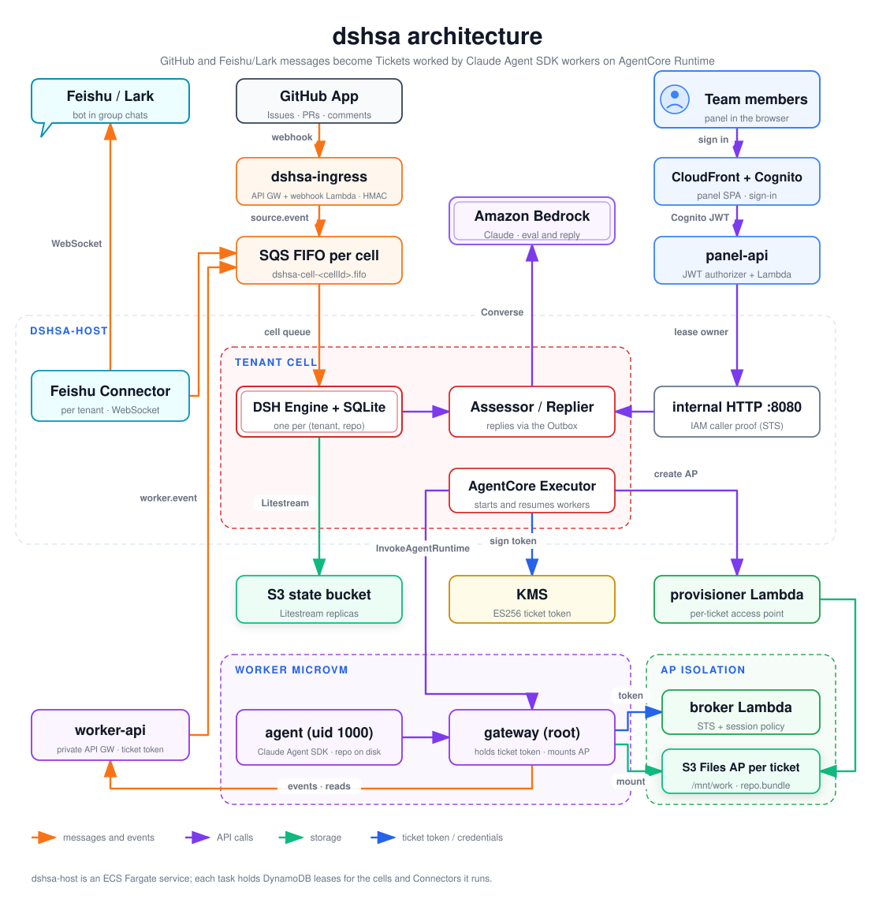

# dshsa: a multi-tenant super agent on AWS

**English** | [简体中文](README.zh-CN.md)

dshsa turns GitHub and Feishu/Lark messages into **Tickets** that coding agents work on. An agent acknowledges each request, opens a pull request, and replies when the work is ready. Workers are [Claude Agent SDK](https://docs.claude.com/en/docs/agent-sdk/overview) agents that run on **Amazon Bedrock AgentCore Runtime**, one microVM session per Ticket. Each Ticket's workspace sits on its own **S3 Files access point**.

It is a port of DeepSeek's **dsh-superagent** prototype (`dsh-superagent-prototype/`, MIT, © 2026 DeepSeek Harness Team) from a single-repository process to a multi-tenant AWS platform. `packages/core` is a near-verbatim copy of its Engine, model and Policy. The per-ticket storage isolation follows the `agentcore-s3files-per-user-isolation` sample.

For depth, see:
- [`docs/design.md`](docs/design.md): architecture, the cross-module contracts (§4) and the security model. This is the source of truth.
- [`research/00-synthesis.md`](research/00-synthesis.md): what was learned from the prototype and the isolation sample, in Chinese.

## Architecture

[](docs/images/architecture.svg)

The dashed boxes are trust boundaries: a **tenant cell** (one Engine per tenant and repository), a **worker microVM** (one per Ticket), and **AP isolation** (each Ticket's storage is reachable only through its own access point). A [PNG](docs/images/architecture.png) is also available.

<details>
<summary>Text version of the diagram</summary>

```
 GitHub App ──webhook──► API GW dshsa-ingress ─► Lambda github-webhook ─┐
                                                                        ▼
 Feishu/Lark ◄──long connection── Feishu Connector ──────────► SQS FIFO dshsa-cell-<cellId>.fifo
                                  (1 per tenant)                        │
            ┌─ ECS Fargate dshsa-host ──────────────────────────────────▼───────────┐
            │  LeaseManager ─► cell runtime ×k: DSH Engine + SQLite ─► Litestream → S3 │
            │                  Assessor / Replier ─► Bedrock Converse                │
            │                  Executor ─► InvokeAgentRuntime   Outbox ─► GitHub/Feishu│
            └──────────▲───────────────────────────────┬────────────────────────────┘
                       │ internal HTTP :8080            │ ticket token (ES256, KMS)
 Panel SPA (CloudFront)│                                ▼
   ─Cognito JWT─► panel-api ──┘        AgentCore Runtime dshsa-worker (1 session per Ticket)
                                         gateway (root) ─► broker Lambda ─► STS + session policy
                                         agent (uid 1000, Claude Agent SDK)  ─► /mnt/work = ticket AP
                                         gateway proxy ─► worker-api (private API GW) ─► cell queue
```

</details>

**Ingress (`dshsa-ingress`).** An HTTP API exposes a single route, `POST /github/webhook`, with stage throttling. Its Lambda verifies GitHub's HMAC signature and looks up the cell in `dshsa-routes` by installation and repository. It then enqueues a `source.event` envelope on that cell's SQS FIFO queue. Feishu/Lark needs no public endpoint: the host dials out over a long connection.

**Host (`dshsa-host`).** An ECS Fargate service (arm64). Each task acquires DynamoDB leases with fencing, so exactly one Engine writes each cell.
- A **cell** is one (tenant, repository) pair: one DSH Engine plus one SQLite file, replicated to the state bucket with Litestream.
- The same lease mechanism runs one **Feishu Connector** per tenant (`connector#<tenantId>`): a WebSocket client plus history backfill.
- Every write to a cell enters through its FIFO queue or its internal HTTP endpoint, both served by the lease owner.

**Bedrock eval and reply (`packages/assess`).** The Assessor decides whether a request becomes a Ticket under the cell's Policy, and the Replier composes the replies. Both make Bedrock Converse tool calls with prompt caching. The defaults are `global.anthropic.claude-sonnet-5-5` for eval and reply and `global.anthropic.claude-opus-5-5` for the worker, and both can be overridden per cell.

**Worker (`dshsa-worker`).** An AgentCore Runtime container (Amazon Linux 2023, arm64). AgentCore runs each session in its own microVM, and one Ticket keeps one `runtimeSessionId`.
- The **gateway** runs as root. It holds the ticket token, mounts the Ticket's S3 Files access point at `/mnt/work` using credentials from the broker, and proxies the agent's control-plane calls.
- The **agent** runs as uid 1000 with NoNewPrivs. It drives the Claude Agent SDK.
- The git working copy lives on local disk, because git on S3 Files measured 17–384× slower. At the end of each turn the agent checkpoints to `/mnt/work/repo.bundle`, and the SDK transcript is kept under `/mnt/work/.claude`. A new microVM on the same session restores both (design §4.10).

**worker-api, provisioner and broker** are Lambdas in `worker/src/dshsa_worker`.
- The **provisioner** creates the per-Ticket access point.
- The **broker** checks the ticket token and returns STS credentials whose session policy allows only that access point.
- **worker-api** is a private API Gateway (AWS_IAM plus a VPC endpoint condition) that also requires the ticket token. It turns worker events (ack, report, handback, …) into cell queue messages and serves GitHub and Feishu reads and short-lived, repository-scoped GitHub credentials.

**Panel (`dshsa-panel`).** A React SPA on CloudFront (OAC) with Cognito sign-in (hosted UI). panel-api is an HTTP API with a JWT authorizer plus a Lambda. It checks the user's tenant group and forwards to the lease owner's internal HTTP endpoint.

## Domain model

| Term | Meaning |
|---|---|
| **Trigger** | One normalized message or event (a comment, a Feishu message, a CI result), with a deterministic id |
| **Thread** | The conversation a Trigger belongs to (`github:<n>`, `feishu:<chat>:<root>`) |
| **Eval** | One Assessor run over the admissible Triggers of a Thread, under the current Policy |
| **Decision** | The Eval's outcome: `accept`, `ignore`, `reopen`, `stop` or `unavailable` |
| **Ticket** | A unit of accepted work, with a title and scope |
| **Assignment** | One worker run of a Ticket (an AgentCore session) |
| **Report** | The worker's state: `progress`, `waiting`, `ready`, `blocked`, `failed` or `dropped`. The Replier turns it into a reply in the original Thread |

## Repository layout

| Path | Content |
|---|---|
| `packages/contracts` | Shared names, zod schemas and types for every cross-module contract, plus a Python mirror (`python/dshsa_contracts.py`) for the worker |
| `packages/core` | The DSH domain core (Engine, model, Policy), ported from the prototype |
| `packages/cell` | The host process: LeaseManager, cell runtime, SQLite + Litestream store, AgentCore Executor, Outbox, internal HTTP API |
| `packages/sources` | The GitHub and Feishu/Lark Sources, the Feishu Connector, and the GitHub webhook Lambda |
| `packages/assess` | The stateless Bedrock model layer for the Assessor and Replier |
| `packages/control-api` | The panel-api Lambda, the `dshsa-admin` CLI for onboarding, and the e2e harness |
| `packages/panel` | The panel SPA (React + Vite) |
| `worker/` | The AgentCore container (`container/`: gateway, agent, Dockerfile) and the broker, provisioner and worker-api Lambdas (`src/dshsa_worker`), in Python |
| `infra/` | The CDK app: `dshsa-shared`, `dshsa-worker`, `dshsa-host`, `dshsa-ingress`, `dshsa-panel` |
| `scripts/` | `deploy.sh`, `destroy.sh`, `e2e/run.sh` |
| `docs/` | Operator guides: GitHub App, Feishu bot, the e2e setup checklist |
| `spikes/` | Risk spikes with reports: S1 git on S3 Files, S2 SDK resume, S3 Feishu WebSocket |
| `research/` | Analysis of the prototype and the isolation sample, in Chinese |
| `dsh-superagent-prototype/` | The upstream prototype, kept read-only as the porting reference |

## Security model

- **Tenants are Cognito groups.** `dshsa-admin tenant add` creates the group. panel-api serves a cell only when the user's `cognito:groups` contains that cell's tenant group.
- **Per-Ticket storage.** Each Ticket has its own S3 Files access point. The broker issues STS credentials with a session policy pinned to that access point's ARN. The file-system policy denies access that does not go through an access point. The AgentCore **execution role has no S3 or S3 Files permissions**.
- **The ticket token is the worker's only authority.** It is an ES256 JWS signed with a KMS key (`alias/dshsa-ticket-token`), lasts at most 2 h, and is scoped to tenant, cell, Ticket and assignment. Only the cell issues it. It stays in the root gateway process, and the agent reaches the control plane through the gateway's local proxy. Only the host role may call `InvokeAgentRuntime`, and nobody may call `InvokeAgentRuntimeCommand`.
- **Internal calls prove the caller's IAM identity.** panel-api and worker-api call the host's internal HTTP endpoint with a presigned `sts:GetCallerIdentity` URL that also signs the target cell. The host executes the URL and checks the returned role ARN. Security groups are a second layer.
- **Webhook HMAC.** Every GitHub delivery is verified against `X-Hub-Signature-256` before anything is parsed, and the check fails closed. The deploy script verifies that unsigned and forged requests are refused.

## Prerequisites

- Node.js ≥ 22.19 (developed on Node 24) and pnpm 10 (`packageManager` is `pnpm@10.27.0`).
- [uv](https://docs.astral.sh/uv/) for the Python worker (Python ≥ 3.12).
- Docker able to build `linux/arm64` images: CDK builds the host and worker images.
- The AWS CLI with admin credentials for the target account. `curl` and `jq` are used by the scripts and docs.
- CDK bootstrapped in the target account and region: `cd infra && pnpm exec cdk bootstrap aws://<account-id>/ap-northeast-1`.
- Bedrock model access to the Claude models above, through their `global.` inference profiles.

## Deploy and destroy

The region is **ap-northeast-1**. It is a constant, not an option: `REGION` in `packages/contracts/src/names.ts` (and its Python mirror), and `AWS_REGION` in `scripts/lib.sh`. Moving regions means changing those, and passing AZ names that map to AgentCore-supported AZ IDs (`DSHSA_AZS`).

The CDK app and the scripts are pinned to one account (`ACCOUNT` in `infra/lib/compose.ts`, `DSHSA_ACCOUNT` in `scripts/lib.sh`). Set `DSHSA_ALLOW_ANY_ACCOUNT=true` to deploy to another account.

```sh
pnpm install
scripts/deploy.sh
```

`deploy.sh` runs these steps:
1. Installs dependencies and builds the panel.
2. Deploys `dshsa-shared`, `dshsa-worker`, `dshsa-host`, `dshsa-ingress` and `dshsa-panel` (or only the stacks you name, e.g. `scripts/deploy.sh dshsa-host`). It refuses any stack name without the `dshsa-` prefix.
3. Writes the outputs to `infra/cdk-outputs.json`.
4. Verifies denial: anonymous panel-api calls must get the authorizer's 401, and `pnpm --filter @dshsa/sources check:ingress` must see unsigned and forged webhooks refused.

The optional environment variables are:
- `DSHSA_VPC_ID`: import an existing VPC instead of creating `dshsa-vpc`.
- `DSHSA_AZS`: a comma-separated list of AZ names.
- `DSHSA_RETAIN=true`: retain data on destroy.
- `DSHSA_DEV_CALLBACK=true`: add a local-dev Cognito callback.

The stack outputs you will need are `GithubWebhookUrl`, `PanelUrl`, `PanelApiUrl`, `HostedUiDomain`, `UserPoolClientId` and `DshsaFileSystemId`.

```sh
scripts/destroy.sh
```

`destroy.sh` asks you to type the account id to confirm, or takes `--yes`. It deletes only what is named `dshsa-*`:
1. The per-cell queues.
2. The per-Ticket access points.
3. The five stacks.
4. The `dshsa/feishu/*` secrets.
5. The `dshsa` log groups.

It then lists anything still tagged `project=dshsa`.

## Onboarding a team

Run these with platform-admin AWS credentials. The full checklist, including the GitHub and Feishu console steps, is [docs/e2e-setup.md](docs/e2e-setup.md). The details are in [docs/github-app.md](docs/github-app.md) and [docs/feishu-bot.md](docs/feishu-bot.md).

```sh
alias admin='pnpm --silent --filter @dshsa/control-api admin'
admin tenant add <tenantId> --name "<Team name>"
admin user add <you@example.com> --tenant <tenantId>
admin github app-set --app-id <APP_ID> --private-key-file <app.private-key.pem>
admin cell add <tenantId> --repo <owner>/<repo> --repo-id <REPO_ID> --installation-id <INSTALLATION_ID> --default-branch main
read -rs FEISHU_APP_SECRET && echo
admin feishu set <tenantId> --domain feishu --app-id <cli_APP_ID> --app-secret "$FEISHU_APP_SECRET"
unset FEISHU_APP_SECRET
admin chat bind <tenantId> <oc_CHAT_ID> <tenantId>--gh<REPO_ID> --name "<chat name>"
```

1. **Tenant**, then a **panel user**. Cognito emails a temporary password.
2. **GitHub App**, once for the whole platform. `app-set` checks the App ID and key with GitHub (`GET /app`) and stores the App's real slug, so `--slug` is optional. Restart the host afterwards, because cells read the slug and key at start.
3. **Cell**: one installed repository. The cell id is `<tenantId>--gh<repoId>`.
4. **Feishu/Lark bot**, once per tenant. Use `--domain lark` for Lark. `read -rs` keeps the App Secret off screen and out of shell history.
5. **Chat binding**: messages in the bound chat go to that cell. The panel's Settings page also lists and edits bindings.
6. **Policy**: in the panel, **Settings → Configuration → Policy** is a JSON editor over `{ "rules": [...], "sources": {...} }`. Leave `rules` as they are, and list who may originate work under `sources`:

   ```json
   "sources": {
     "github": { "allowed": [{ "id": "<github-login>" }] },
     "feishu": { "allowed": [{ "id": "ou_<open_id>", "name": "<optional display name>" }] }
   }
   ```

   GitHub entries take `id` only. Feishu entries take an `open_id` (`ou_…`) and an optional `name`. The host validates the block on save.

**Eval mode** (`Settings → Configuration → Eval`, `mode`: `off` | `observe` | `auto`; the default is `observe`) only affects **inferred** messages, the ones that don't @-mention the agent and aren't direct messages. With `observe`, they are evaluated and recorded as "would accept", and nothing else happens. With `auto`, they can become Tickets. With `off`, they are not evaluated. An explicit @-mention or direct message from an allowed person is evaluated in every mode.

## Development

```sh
pnpm install
pnpm typecheck
pnpm test
pnpm check
pnpm --filter @dshsa/sources test
pnpm --filter @dshsa/infra test
pnpm --filter @dshsa/infra synth
pnpm --filter @dshsa/panel dev
```

`pnpm check` runs both typecheck and test across the workspace. Every package (`contracts`, `core`, `cell`, `sources`, `assess`, `control-api`, `panel`, `infra`) has `typecheck` and `test` scripts, run with `pnpm --filter @dshsa/<name> <script>`.

The worker uses Python with uv:

```sh
cd worker
uv run pytest -q
uv run ruff check .
uv run python tests/smoke/local_smoke.py
uv run python tests/isolation_test.py --region ap-northeast-1
```

- `local_smoke.py` runs the worker image in Docker: two containers share one work volume, and only Bedrock is called. The second container must resume the SDK session.
- `isolation_test.py` is the deployed A3/A4 isolation and resume test. It needs admin credentials and uses tenant `isotest`. It deletes the tickets' access points at the end unless `--keep` is given.

The e2e harness runs against the deployed platform. It creates `e2e<run>`-prefixed tenants, cells and users and removes them afterwards unless `--keep` is given:

```sh
scripts/e2e/run.sh
scripts/e2e/run.sh --only panel
scripts/e2e/run.sh --strict --wait 60
```

## Status (verified live on 2026-11-01)

- **A2, GitHub**: an Issue mention → acknowledgement → PR from the App's bot → ready reply.
- **A2, Feishu**: a bound-chat mention → Ticket → PR.
- **A3/A4 isolation and resume**: 19/19 (`worker/tests/isolation_test.py`).
- **A5 panel tenant isolation**: a tenant sees and acts on only its own cells (`scripts/e2e/run.sh`).
- **Ingress gate**: unsigned and forged webhooks are refused (`check:ingress`).

Known gaps:
- Rejected Triggers are not logged with their reason.
- The panel's Policy page is a raw JSON editor.
- A6 (an unauthorized or unaddressed message produces no Ticket) and A7 (destroy leaves nothing behind) are not yet automated end to end. `run.sh` has an A6 step; the live A2–A5 steps there are placeholders.
- **Rotate the GitHub webhook secret before production.** Run `admin github app-set … --webhook-secret <new>` and set the same value in the App.

## Troubleshooting

Host logs are in the CloudWatch log group `/dshsa/host`. The webhook Lambda logs to `/dshsa/ingress-github-webhook`, and panel-api to `/dshsa/panel-api`.

| Log message | Meaning |
|---|---|
| `feishu.health` | Connector state per tenant: `starting`, `ready` (detail `Listening for bot events`) or `error` with the cause |
| `feishu.unrouted` | A message arrived from a chat that isn't bound. Its `chatId` is what `admin chat bind` needs |
| `poison envelope dropped` | A cell-queue message was not a valid envelope and was deleted so it doesn't block the cell's FIFO group; the parse error is in the entry |
| `worker event refused` | The domain refused a worker event (for example, a report on an ended Ticket). It is recorded and not retried |

- **The slug is not the Client ID.** The App slug is the last part of `github.com/apps/<slug>`, the name people @-mention. The Client ID (`Iv…`) is something else. `admin github app-set` reads the slug from GitHub and refuses a wrong `--slug`.
- **Webhook 401 / 503**: see the troubleshooting table in [docs/e2e-setup.md](docs/e2e-setup.md).
- **Feishu console won't save long-connection mode**: run `admin feishu set` first, then wait for `feishu.health` `ready`.
