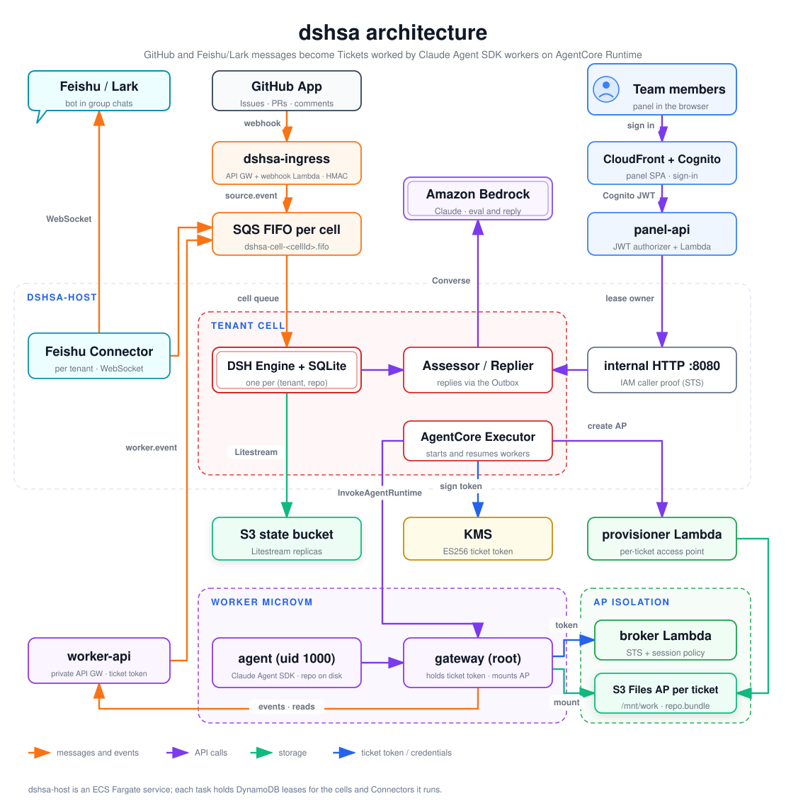

# dshsa：AWS 上的多租户超级智能体

[English](README.md) | **简体中文**

dshsa 把 GitHub 和飞书/Lark 中的消息转成 **Ticket**（工单），交给编码智能体处理：智能体先确认收到请求，再提交 Pull Request，完成后回复。Worker 是运行在 **Amazon Bedrock AgentCore Runtime** 上的 [Claude Agent SDK](https://docs.claude.com/en/docs/agent-sdk/overview) 智能体，每个 Ticket 独占一个 microVM 会话，工作区位于该 Ticket 专属的 **S3 Files 访问点**（access point，下文简称 AP）上。

本项目移植自 DeepSeek 的 **dsh-superagent** 原型（`dsh-superagent-prototype/`，MIT 许可，© 2026 DeepSeek Harness Team），把单仓库进程改造为多租户 AWS 平台。`packages/core` 几乎原样复制了原型的 Engine、领域模型和 Policy。按 Ticket 隔离存储的做法参考了 `agentcore-s3files-per-user-isolation` 示例。

深入阅读：
- [`docs/design.md`](docs/design.md)：架构、跨模块契约（§4）和安全模型，是唯一权威来源。
- [`research/00-synthesis.md`](research/00-synthesis.md)：对原型和隔离示例的分析总结（中文）。

## 架构

[](docs/images/architecture.svg)

图中虚线框是信任边界：**tenant cell**（每个租户和仓库一个 Engine）、**worker microVM**（每个 Ticket 一个）和 **AP isolation**（每个 Ticket 的存储只能经由它自己的访问点访问）。另有 [PNG 版本](docs/images/architecture.png)。

<details>
<summary>架构图的文本版</summary>

```
 GitHub App ──webhook──► API GW dshsa-ingress ─► Lambda github-webhook ─┐
                                                                        ▼
 Feishu/Lark ◄──long connection── Feishu Connector ──────────► SQS FIFO dshsa-cell-<cellId>.fifo
                                  (1 per tenant)                        │
            ┌─ ECS Fargate dshsa-host ──────────────────────────────────▼───────────┐
            │  LeaseManager ─► cell runtime ×k: DSH Engine + SQLite ─► Litestream → S3 │
            │                  Assessor / Replier ─► Bedrock Converse                │
            │                  Executor ─► InvokeAgentRuntime   Outbox ─► GitHub/Feishu│
            └──────────▲───────────────────────────────┬────────────────────────────┘
                       │ internal HTTP :8080            │ ticket token (ES256, KMS)
 Panel SPA (CloudFront)│                                ▼
   ─Cognito JWT─► panel-api ──┘        AgentCore Runtime dshsa-worker (1 session per Ticket)
                                         gateway (root) ─► broker Lambda ─► STS + session policy
                                         agent (uid 1000, Claude Agent SDK)  ─► /mnt/work = ticket AP
                                         gateway proxy ─► worker-api (private API GW) ─► cell queue
```

</details>

**接入层（`dshsa-ingress`）。** 一个 HTTP API，只开放 `POST /github/webhook` 一条路由，并在 stage 上限流。它的 Lambda 校验 GitHub 的 HMAC 签名，按 installation 和仓库在 `dshsa-routes` 中查到对应的 cell，再把一个 `source.event` 信封投递到该 cell 的 SQS FIFO 队列。飞书/Lark 不需要公网入口：host 通过长连接主动连出去。

**Host（`dshsa-host`）。** 一个 ECS Fargate 服务（arm64）。每个任务通过带 fencing 的 DynamoDB 租约认领 cell，确保每个 cell 只有一个 Engine 在写。
- 一个 **cell** 对应一组（租户，仓库）：一个 DSH Engine 加一个 SQLite 文件，由 Litestream 复制到 state 桶。
- 同样的租约机制为每个租户运行一个 **Feishu Connector**（`connector#<tenantId>`），包含 WebSocket 客户端和历史消息补拉。
- 对 cell 的所有写入都经由它的 FIFO 队列或内部 HTTP 端点进入，两者都由租约持有者处理。

**Bedrock 评估与回复（`packages/assess`）。** Assessor 依据 cell 的 Policy 判断一个请求是否成为 Ticket，Replier 负责撰写回复。两者都通过 Bedrock Converse 的工具调用实现，并使用提示词缓存。默认模型：评估和回复用 `global.anthropic.claude-sonnet-5-5`，worker 用 `global.anthropic.claude-opus-5-5`，两者都可以按 cell 覆盖。

**Worker（`dshsa-worker`）。** 一个 AgentCore Runtime 容器（Amazon Linux 2023，arm64）。AgentCore 让每个会话运行在独立的 microVM 中，一个 Ticket 始终使用同一个 `runtimeSessionId`。
- **gateway** 以 root 运行：持有 ticket token，用 broker 签发的凭证把该 Ticket 的 S3 Files 访问点挂载到 `/mnt/work`，并代理智能体对控制面的调用。
- **agent** 以 uid 1000 运行，并设置 NoNewPrivs，负责驱动 Claude Agent SDK。
- git 工作副本放在本地磁盘上，因为实测在 S3 Files 上运行 git 慢 17–384 倍。每轮结束时，agent 把检查点写入 `/mnt/work/repo.bundle`，SDK 的会话记录保存在 `/mnt/work/.claude` 下。同一会话换到新的 microVM 后会恢复这两者（design §4.10）。

**worker-api、provisioner 和 broker** 是 `worker/src/dshsa_worker` 中的三个 Lambda。
- **provisioner** 为每个 Ticket 创建访问点。
- **broker** 校验 ticket token，返回 STS 凭证，其会话策略只允许访问该访问点。
- **worker-api** 是一个私有 API Gateway（AWS_IAM 加 VPC 端点条件），同时要求 ticket token。它把 worker 事件（ack、report、handback 等）转成 cell 队列消息，并提供 GitHub 和飞书的读取接口，以及短期有效、限定到仓库的 GitHub 凭证。

**面板（`dshsa-panel`）。** 一个部署在 CloudFront（OAC）上的 React SPA，使用 Cognito 登录（托管 UI）。panel-api 由带 JWT 授权器的 HTTP API 和一个 Lambda 组成，它检查用户所属的租户组，再把请求转发到租约持有者的内部 HTTP 端点。

## 领域模型

| 术语 | 含义 |
|---|---|
| **Trigger** | 一条规范化后的消息或事件（评论、飞书消息、CI 结果），带确定性 id |
| **Thread** | Trigger 所属的会话（`github:<n>`、`feishu:<chat>:<root>`） |
| **Eval** | 在当前 Policy 下，Assessor 对一个 Thread 中可受理的 Trigger 做的一次评估 |
| **Decision** | Eval 的结论：`accept`、`ignore`、`reopen`、`stop` 或 `unavailable` |
| **Ticket** | 一项被受理的工作，带标题和范围 |
| **Assignment** | Ticket 的一次 worker 运行（一个 AgentCore 会话） |
| **Report** | worker 上报的状态：`progress`、`waiting`、`ready`、`blocked`、`failed` 或 `dropped`。Replier 据此在原 Thread 中回复 |

## 仓库结构

| 路径 | 内容 |
|---|---|
| `packages/contracts` | 所有跨模块契约的共享名称、zod schema 和类型，另有供 worker 使用的 Python 镜像（`python/dshsa_contracts.py`） |
| `packages/core` | 从原型移植的 DSH 领域核心（Engine、模型、Policy） |
| `packages/cell` | host 进程：LeaseManager、cell 运行时、SQLite + Litestream 存储、AgentCore Executor、Outbox、内部 HTTP API |
| `packages/sources` | GitHub 和飞书/Lark Source、Feishu Connector，以及 GitHub webhook Lambda |
| `packages/assess` | 供 Assessor 和 Replier 使用的无状态 Bedrock 模型层 |
| `packages/control-api` | panel-api Lambda、用于接入的 `dshsa-admin` CLI，以及 e2e 测试框架 |
| `packages/panel` | 面板 SPA（React + Vite） |
| `worker/` | AgentCore 容器（`container/`：gateway、agent、Dockerfile），以及 broker、provisioner 和 worker-api 三个 Lambda（`src/dshsa_worker`），均为 Python |
| `infra/` | CDK 应用：`dshsa-shared`、`dshsa-worker`、`dshsa-host`、`dshsa-ingress`、`dshsa-panel` |
| `scripts/` | `deploy.sh`、`destroy.sh`、`e2e/run.sh` |
| `docs/` | 运维指南：GitHub App、飞书机器人、e2e 搭建清单 |
| `spikes/` | 风险验证及报告：S1 S3 Files 上的 git、S2 SDK 会话恢复、S3 飞书 WebSocket |
| `research/` | 对原型和隔离示例的分析（中文） |
| `dsh-superagent-prototype/` | 上游原型，只读保留，作为移植参考 |

## 安全模型

- **租户即 Cognito 组。** `dshsa-admin tenant add` 会创建对应的组。只有当用户的 `cognito:groups` 包含某个 cell 所属租户的组时，panel-api 才会为其服务该 cell。
- **按 Ticket 隔离存储。** 每个 Ticket 有自己的 S3 Files 访问点。broker 签发的 STS 凭证带有会话策略，固定到该访问点的 ARN。文件系统策略拒绝一切不经访问点的访问。AgentCore 的**执行角色没有任何 S3 或 S3 Files 权限**。
- **ticket token 是 worker 唯一的权限来源。** 它是用 KMS 密钥（`alias/dshsa-ticket-token`）签名的 ES256 JWS，最长有效 2 小时，范围限定到租户、cell、Ticket 和 assignment，只有 cell 能签发。它只保存在以 root 运行的 gateway 进程中，agent 通过 gateway 的本地代理访问控制面。只有 host 角色可以调用 `InvokeAgentRuntime`，任何角色都不能调用 `InvokeAgentRuntimeCommand`。
- **内部调用要证明调用方的 IAM 身份。** panel-api 和 worker-api 调用 host 的内部 HTTP 端点时，附带一个预签名的 `sts:GetCallerIdentity` URL，签名同时覆盖目标 cell。host 执行这个 URL 并核对返回的角色 ARN。安全组是第二道防线。
- **Webhook HMAC。** 每次 GitHub 投递都会在解析任何内容之前校验 `X-Hub-Signature-256`，校验失败一律拒绝（fail closed）。部署脚本会验证未签名和伪造签名的请求确实被拒绝。

## 前置条件

- Node.js ≥ 22.19（开发时使用 Node 24）和 pnpm 10（`packageManager` 为 `pnpm@10.27.0`）。
- 用于 Python worker 的 [uv](https://docs.astral.sh/uv/)（Python ≥ 3.12）。
- 能构建 `linux/arm64` 镜像的 Docker：CDK 会构建 host 和 worker 镜像。
- AWS CLI，以及目标账号的管理员凭证。脚本和文档会用到 `curl` 和 `jq`。
- 在目标账号和区域完成 CDK bootstrap：`cd infra && pnpm exec cdk bootstrap aws://<account-id>/ap-northeast-1`。
- 已开通上述 Claude 模型在 Bedrock 上的访问权限（通过 `global.` 推理配置文件）。

## 部署与销毁

区域是 **ap-northeast-1**。它是常量而不是选项：定义在 `packages/contracts/src/names.ts` 的 `REGION`（及其 Python 镜像）和 `scripts/lib.sh` 的 `AWS_REGION` 中。换区域需要修改这些位置，并通过 `DSHSA_AZS` 传入映射到 AgentCore 支持的 AZ ID 的可用区名称。

CDK 应用和脚本都固定到一个账号（`infra/lib/compose.ts` 中的 `ACCOUNT`、`scripts/lib.sh` 中的 `DSHSA_ACCOUNT`）。要部署到其他账号，设置 `DSHSA_ALLOW_ANY_ACCOUNT=true`。

```sh
pnpm install
scripts/deploy.sh
```

`deploy.sh` 依次执行：
1. 安装依赖并构建面板。
2. 部署 `dshsa-shared`、`dshsa-worker`、`dshsa-host`、`dshsa-ingress` 和 `dshsa-panel`（也可以只部署指定的栈，例如 `scripts/deploy.sh dshsa-host`）。名称不以 `dshsa-` 开头的栈一律拒绝。
3. 把栈输出写入 `infra/cdk-outputs.json`。
4. 验证拒绝行为：匿名调用 panel-api 必须收到授权器的 401，`pnpm --filter @dshsa/sources check:ingress` 必须确认未签名和伪造签名的 webhook 被拒绝。

可选环境变量：
- `DSHSA_VPC_ID`：导入已有 VPC，而不是新建 `dshsa-vpc`。
- `DSHSA_AZS`：逗号分隔的可用区名称列表。
- `DSHSA_RETAIN=true`：销毁时保留数据。
- `DSHSA_DEV_CALLBACK=true`：添加用于本地开发的 Cognito 回调地址。

之后会用到的栈输出有 `GithubWebhookUrl`、`PanelUrl`、`PanelApiUrl`、`HostedUiDomain`、`UserPoolClientId` 和 `DshsaFileSystemId`。

```sh
scripts/destroy.sh
```

`destroy.sh` 会要求输入账号 id 确认，也可以传 `--yes` 跳过。它只删除名为 `dshsa-*` 的资源：
1. 每个 cell 的队列。
2. 每个 Ticket 的访问点。
3. 五个栈。
4. `dshsa/feishu/*` 密钥。
5. `dshsa` 日志组。

最后列出仍带有 `project=dshsa` 标签的资源。

## 接入一个团队

以下命令需要平台管理员的 AWS 凭证。完整清单（包括 GitHub 和飞书控制台中的步骤）见 [docs/e2e-setup.md](docs/e2e-setup.md)，细节见 [docs/github-app.md](docs/github-app.md) 和 [docs/feishu-bot.md](docs/feishu-bot.md)。

```sh
alias admin='pnpm --silent --filter @dshsa/control-api admin'
admin tenant add <tenantId> --name "<Team name>"
admin user add <you@example.com> --tenant <tenantId>
admin github app-set --app-id <APP_ID> --private-key-file <app.private-key.pem>
admin cell add <tenantId> --repo <owner>/<repo> --repo-id <REPO_ID> --installation-id <INSTALLATION_ID> --default-branch main
read -rs FEISHU_APP_SECRET && echo
admin feishu set <tenantId> --domain feishu --app-id <cli_APP_ID> --app-secret "$FEISHU_APP_SECRET"
unset FEISHU_APP_SECRET
admin chat bind <tenantId> <oc_CHAT_ID> <tenantId>--gh<REPO_ID> --name "<chat name>"
```

1. 先建**租户**，再建**面板用户**。Cognito 会通过邮件发送临时密码。
2. **GitHub App**，整个平台只需配置一次。`app-set` 会向 GitHub（`GET /app`）核对 App ID 和私钥，并保存 App 的真实 slug，所以 `--slug` 可以省略。完成后要重启 host，因为 cell 只在启动时读取 slug 和私钥。
3. **Cell**：对应一个已安装 App 的仓库，cell id 为 `<tenantId>--gh<repoId>`。
4. **飞书/Lark 机器人**，每个租户配置一次。Lark 使用 `--domain lark`。`read -rs` 不回显输入，App Secret 不会出现在屏幕上或 shell 历史中。
5. **群聊绑定**：被绑定群里的消息会进入对应的 cell。面板的 Settings 页面也可以查看和编辑绑定。
6. **Policy**：在面板中，**Settings → Configuration → Policy** 是一个 JSON 编辑器，内容为 `{ "rules": [...], "sources": {...} }`。保持 `rules` 不变，在 `sources` 下列出可以发起工作的人：

   ```json
   "sources": {
     "github": { "allowed": [{ "id": "<github-login>" }] },
     "feishu": { "allowed": [{ "id": "ou_<open_id>", "name": "<optional display name>" }] }
   }
   ```

   GitHub 条目只有 `id`。飞书条目包含 `open_id`（`ou_…`）和可选的 `name`。保存时由 host 校验整个配置块。

**Eval 模式**（`Settings → Configuration → Eval` 中的 `mode`，可选 `off` | `observe` | `auto`，默认 `observe`）只影响**推断类**消息，即没有 @ 智能体、也不是私聊的消息。`observe` 下这类消息会被评估并记为"本会受理"（would accept），但不做任何处理；`auto` 下它们可以成为 Ticket；`off` 下不做评估。名单内的人明确 @ 智能体或私聊它时，无论哪种模式都会被评估。

## 开发

```sh
pnpm install
pnpm typecheck
pnpm test
pnpm check
pnpm --filter @dshsa/sources test
pnpm --filter @dshsa/infra test
pnpm --filter @dshsa/infra synth
pnpm --filter @dshsa/panel dev
```

`pnpm check` 会对整个工作区依次运行类型检查和测试。每个包（`contracts`、`core`、`cell`、`sources`、`assess`、`control-api`、`panel`、`infra`）都有 `typecheck` 和 `test` 脚本，用 `pnpm --filter @dshsa/<name> <script>` 运行。

worker 使用 Python 和 uv：

```sh
cd worker
uv run pytest -q
uv run ruff check .
uv run python tests/smoke/local_smoke.py
uv run python tests/isolation_test.py --region ap-northeast-1
```

- `local_smoke.py` 在 Docker 中运行 worker 镜像：两个容器共享一个工作卷，只调用 Bedrock，第二个容器必须恢复 SDK 会话。
- `isolation_test.py` 是针对已部署环境的 A3/A4 隔离与恢复测试，需要管理员凭证，使用租户 `isotest`。结束时会删除测试 Ticket 的访问点，除非传入 `--keep`。

e2e 测试框架针对已部署的平台运行。它创建以 `e2e<run>` 为前缀的租户、cell 和用户，结束后删除，除非传入 `--keep`：

```sh
scripts/e2e/run.sh
scripts/e2e/run.sh --only panel
scripts/e2e/run.sh --strict --wait 60
```

## 状态（2026-11-01 线上验证）

- **A2，GitHub**：在 Issue 中 @ → 确认回复 → App 机器人提交 PR → 完成回复。
- **A2，飞书**：在已绑定群里 @ → Ticket → PR。
- **A3/A4 隔离与恢复**：19/19（`worker/tests/isolation_test.py`）。
- **A5 面板租户隔离**：租户只能看到和操作自己的 cell（`scripts/e2e/run.sh`）。
- **接入层校验**：未签名和伪造签名的 webhook 被拒绝（`check:ingress`）。

已知不足：
- 被拒绝的 Trigger 不会连同原因记录到日志。
- 面板的 Policy 页面只是原始 JSON 编辑器。
- A6（未授权或未 @ 的消息不产生 Ticket）和 A7（销毁后不留残余）尚未端到端自动化。`run.sh` 中已有 A6 步骤，其中 A2–A5 的线上步骤仍是占位。
- **上生产前请轮换 GitHub webhook 密钥。** 运行 `admin github app-set … --webhook-secret <new>`，并在 App 中填入同一个值。

## 故障排查

host 日志在 CloudWatch 日志组 `/dshsa/host` 中。webhook Lambda 的日志在 `/dshsa/ingress-github-webhook`，panel-api 的在 `/dshsa/panel-api`。

| 日志消息 | 含义 |
|---|---|
| `feishu.health` | 每个租户的 Connector 状态：`starting`、`ready`（detail 为 `Listening for bot events`）或附带原因的 `error` |
| `feishu.unrouted` | 收到了来自未绑定群的消息。日志中的 `chatId` 就是 `admin chat bind` 需要的值 |
| `poison envelope dropped` | cell 队列中的一条消息不是合法信封，已被删除，以免阻塞该 cell 的 FIFO 消息组；日志中带有解析错误 |
| `worker event refused` | 领域层拒绝了一个 worker 事件（例如对已结束 Ticket 的 report）。它会被记录下来，不再重试 |

- **slug 不是 Client ID。** App 的 slug 是 `github.com/apps/<slug>` 的最后一段，也就是大家 @ 的名字；Client ID（`Iv…`）是另一回事。`admin github app-set` 会从 GitHub 读取 slug，并拒绝错误的 `--slug`。
- **Webhook 返回 401 / 503**：见 [docs/e2e-setup.md](docs/e2e-setup.md) 中的故障排查表。
- **飞书控制台无法保存长连接模式**：先运行 `admin feishu set`，等到 `feishu.health` 变为 `ready` 再保存。
