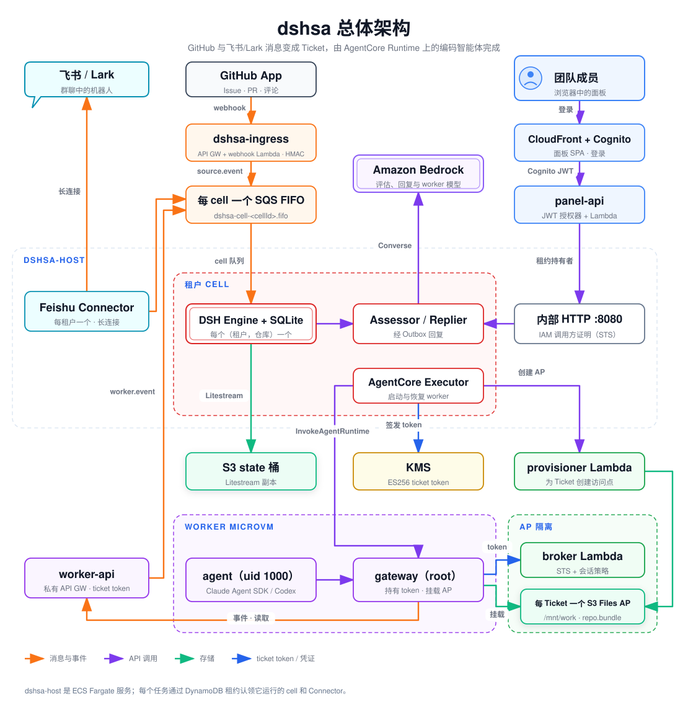
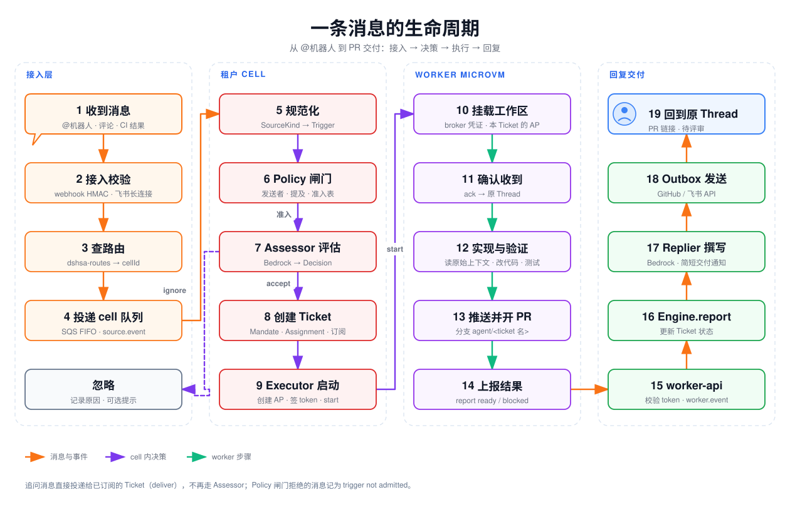
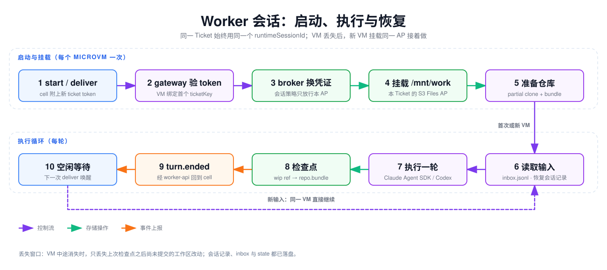
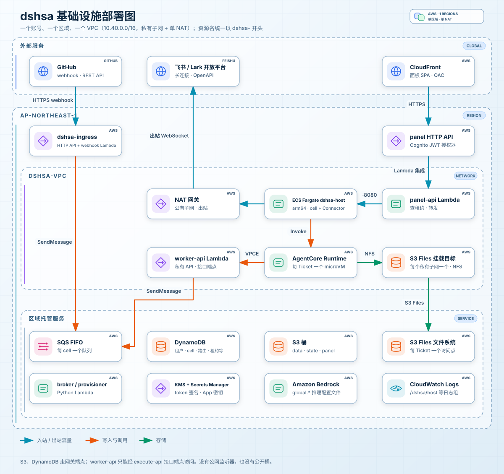

# dshsa 架构设计文档

> 适用版本：契约 v7（2026-11）。本文面向第一次接触本项目的工程师，讲清楚“系统由什么组成、一条消息怎么走、数据放在哪、安全边界在哪里”。跨模块契约的字段级定义以 [`design.md`](design.md) 为准；本文与它冲突时，以 `design.md` 为准。

## 目录

1. [一句话概括](#1-一句话概括)
2. [核心概念](#2-核心概念)
3. [总体架构](#3-总体架构)
4. [一条消息的生命周期](#4-一条消息的生命周期)
5. [Worker：启动、执行与恢复](#5-worker启动执行与恢复)
6. [基础设施部署](#6-基础设施部署)
7. [数据与状态](#7-数据与状态)
8. [安全模型](#8-安全模型)
9. [可用性、扩展与运维](#9-可用性扩展与运维)
10. [关键设计取舍](#10-关键设计取舍)
11. [延伸阅读](#11-延伸阅读)

## 1. 一句话概括

**dshsa 把 GitHub 和飞书/Lark 里 @机器人 的消息变成 Ticket（工单），交给运行在 Amazon Bedrock AgentCore Runtime 上的编码智能体完成，最后把 PR 链接回复到原来的会话里。**

它移植自 DeepSeek 的 dsh-superagent 原型（MIT），把原型的“单仓库、单进程”改造成多租户 AWS 平台。改造遵循四条原则：

| 原则 | 含义 |
|---|---|
| **领域核心原样复用** | `packages/core` 是原型 Engine、领域模型和 Policy 的拷贝，只允许改适配层，行为与原型保持一致 |
| **每个 cell 单写者** | 一个 cell =（租户，仓库），只有一个 Engine 写它的 SQLite；靠 DynamoDB 租约 + fencing 保证 |
| **Worker 不可信** | worker 唯一的权限来源是 ticket token，能触及的一切都限定在（租户，cell，Ticket）之内 |
| **默认拒绝（fail closed）** | 先鉴权再产生副作用；校验失败一律拒绝；密钥只写不读、不进日志 |

## 2. 核心概念

先认识几个贯穿全文的名词：

| 术语 | 含义 | 例子 |
|---|---|---|
| **租户（tenant）** | 一个团队，对应一组 Cognito 组 | `acme` |
| **cell** | 一个（租户，GitHub 仓库）组合，拥有自己的 Engine、SQLite 和 SQS FIFO 队列 | `acme--gh812345` |
| **Trigger** | 一条规范化后的消息或事件（评论、飞书消息、CI 结果），id 是确定性的，重复投递会合并 | — |
| **Thread** | Trigger 所属的会话 | `github:12`、`feishu:<chat>:<root>` |
| **Eval / Decision** | Assessor 在当前 Policy 下对可受理 Trigger 的一次评估及其结论：`accept`、`ignore`、`reopen`、`stop`、`unavailable` | — |
| **Ticket** | 一项被受理的工作，带标题和范围 | “编写架构设计文档” |
| **Assignment** | Ticket 的一次 worker 运行（对应一个 AgentCore 会话） | — |
| **Report** | worker 上报的状态：`progress`、`waiting`、`ready`、`blocked`、`failed`、`dropped` | — |
| **AP** | S3 Files 访问点（access point），每个 Ticket 一个，是 worker 的持久工作区 | `/tenants/acme/<cellId>/<ticketKey>` |

可以把系统想成一家“接单公司”：**接入层**是前台收件，**cell** 是调度员（判断要不要接、派给谁、结果怎么回），**worker** 是独立隔间里干活的工程师，**AP** 是每个工程师上锁的柜子。

## 3. 总体架构

> 图中三个虚线框是信任边界：**租户 cell**（每个租户和仓库一个 Engine）、**Worker microVM**（每个 Ticket 一个）、**AP 隔离**（每个 Ticket 的存储只能经由它自己的访问点访问）。[PNG 版本](images/zh/architecture.png)

系统分为五块，与五个 CDK 栈一一对应（`dshsa-shared` 提供它们共用的网络、表、密钥和用户池）：

### 3.1 接入层（`dshsa-ingress` + Feishu Connector）

- **GitHub**：一个只有 `POST /github/webhook` 一条路由的 HTTP API，stage 上限流。Lambda 先校验 `X-Hub-Signature-256`（HMAC），再按 installation 和仓库查 `dshsa-routes` 找到 cell，把原始负载包成 `source.event` 信封投进该 cell 的 SQS FIFO 队列。
- **飞书/Lark**：**没有公网入口**。host 为每个租户运行一个 Feishu Connector，主动建立长连接（WebSocket）并做历史补拉，同样把消息投进 cell 队列。
- 两条路径都只做“校验 + 路由 + 入队”，不解析业务语义。规范化由 cell 完成，所以 webhook、对账、补拉带来的重复消息会因确定性 id 而合并。

### 3.2 Host 与 cell（`dshsa-host`）

一个 ECS Fargate 服务（arm64）。每个任务用 **LeaseManager** 去 DynamoDB 认领 cell 租约和 Connector 租约，认领成功后在进程内运行：

| 组件 | 职责 |
|---|---|
| **DSH Engine + SQLite** | 领域状态机：Trigger → Eval → Decision → Ticket → Assignment → Report。SQLite 由 Litestream 持续复制到 state 桶 |
| **Assessor / Replier** | 无状态的 Bedrock Converse 调用（`packages/assess`）。Assessor 依据 Policy 判断是否受理；Replier 根据 worker 报告撰写简短回复 |
| **AgentCore Executor** | 为 Ticket 创建 AP、签发 ticket token、调用 `InvokeAgentRuntime`（start / deliver / stop / status） |
| **Outbox** | 把待发送的回复、确认可靠地发到 GitHub / 飞书 API |
| **内部 HTTP :8080** | 仅 VPC 内可达，供 panel-api（`/{cellId}/api/*`）和 worker-api（`/{cellId}/worker/*`）调用 |

对一个 cell 的**所有写入**只有两个入口：它的 FIFO 队列和它的内部 HTTP 端点，二者都只由租约持有者处理。

### 3.3 Worker（`dshsa-worker`）

一个 AgentCore Runtime 容器（Amazon Linux 2023，arm64）。每个 Ticket 固定使用同一个 `runtimeSessionId`，AgentCore 让每个会话跑在独立的 microVM 中。容器内有两个进程：

- **gateway（root）**：唯一持有 ticket token 的进程。它验 token、向 broker 换取只能挂载本 Ticket AP 的凭证、把 AP 挂到 `/mnt/work`，并在 `127.0.0.1:8090/cp/*` 为 agent 代理控制面请求（自动注入 token，剥掉 agent 自己设的 `x-dshsa-*` 头）。
- **agent（uid 1000，NoNewPrivs）**：驱动 Claude Agent SDK，或在 Codex 类型的 runtime 中驱动 OpenAI `codex app-server`。git 工作副本在 microVM 本地磁盘上。

配套的三个 Python Lambda：

| Lambda | 作用 |
|---|---|
| **provisioner** | 为 Ticket 创建 S3 Files 访问点，写 `dshsa-ticket-storage` |
| **broker** | 校验 ticket token，返回 STS 凭证，其会话策略限定为该 AP 的 ARN |
| **worker-api** | 私有 API Gateway（AWS_IAM + VPC 端点条件），同时要求 ticket token。把 worker 事件（ack、report、handback…）转成 cell 队列消息；提供只读的 GitHub/飞书读取接口，以及限定到本仓库、最长 1 小时的 GitHub 安装令牌 |

### 3.4 面板（`dshsa-panel`）

CloudFront（OAC）托管的 React SPA，Cognito 托管 UI 登录。panel-api 是带 JWT 授权器的 HTTP API + Lambda：先检查用户的 `cognito:groups` 是否包含该 cell 所属租户的组，再从 `dshsa-leases` 查出租约持有者的地址，转发到它的内部 HTTP 端点。面板还负责租户自助接入（GitHub App 安装、飞书机器人、群聊绑定），详见 [`onboarding-design.md`](onboarding-design.md)。

## 4. 一条消息的生命周期

> [PNG 版本](images/zh/lifecycle.png)

以“在飞书群里 @机器人 让它写文档”为例，按图中编号说明：

**接入（1–4）**
1. 消息到达：GitHub 推 webhook，或飞书长连接收到 `im.message.receive_v1`。
2. 接入校验：GitHub 校验 HMAC；飞书由 Connector 用租户的应用凭证建立连接。
3. 查路由：`gh#<installationId>#<repoId>` 或 `fs#<tenantId>#<chatId>` → `cellId`。
4. 投递：`source.event` 信封进入 `dshsa-cell-<cellId>.fifo`（`MessageGroupId = cellId`，按信封 id 去重）。

**决策（5–9，cell 内）**

5. 规范化：`packages/sources` 中的 SourceKind 把原始负载转成 Trigger。
6. Policy 闸门：检查发送者、是否 @ 了机器人、准入表等。被拒绝的消息记为日志 `trigger not admitted`，不进入评估。
7. Assessor 评估：调用 Bedrock，给出 Decision。`ignore` 会记录原因（日志 `decision ignored`，面板 Overview 可查），并按设置可选地回一条提示。
8. 创建 Ticket：`accept` 时原子地创建 Ticket、Mandate、Assignment、订阅关系和确认回复。
9. Executor 启动：调 provisioner 创建 AP → 用 KMS 签发 ticket token → `InvokeAgentRuntime start`。

**执行（10–14，worker 内）**

10. gateway 挂载本 Ticket 的 AP。
11. agent 调用 `ack`，确认回复经 Outbox 发到原 Thread。
12. agent 自己读取原始消息、Thread 历史和代码，实现并验证。
13. 推送分支、创建 PR。
14. `report ready`（或 `blocked` 并附一个需要人回答的问题）。

**回复（15–19）**

15. worker-api 校验 token，把事件作为 `worker.event` 投回 cell 队列（附上从 token 中取出的 `verified` 身份）。
16. Engine 处理 Report，更新 Ticket 状态。
17. Replier 撰写简短的交付通知。
18. Outbox 调 GitHub / 飞书 API 发送。
19. 提问人在原 Thread 中收到 PR 链接。

**其他路径**

- **追问（follow-up）**：已订阅 Thread 中的新消息直接投递给对应 Ticket（Executor `deliver`，附新 token），由 worker 判断是否属于本 Ticket；不属于则 `handback` 退回给 cell 重新评估。
- **停止**：有权限的人要求停止时，Decision 为 `stop`，Executor 发 `stop`，取消当前轮次但保留 inbox。
- **PR 合并或关闭**：结束绑定的 Ticket；之后有人在该 PR 下继续说话，会以原授权恢复 Ticket。

## 5. Worker：启动、执行与恢复

> [PNG 版本](images/zh/worker-session.png)

### 5.1 启动与挂载

- `start` 对同一 `assignmentId` 幂等；`deliver` 按输入 id 去重后追加到 inbox。二者都会带上最新的 `config`（模型、effort、系统提示词、skills），因此设置变更从下一轮生效。
- 一个 microVM 在收到第一个 token 后就绑定到该 token 的 `ticketKey`，之后不接受其他 Ticket。
- gateway 拒绝与自身镜像类型不符的 `config.agent`（Claude / Codex），且在任何副作用之前完成 token 校验。
- AgentCore 要求 `/invocations` 总是返回 HTTP 200，错误放在 body 的 `{ ok: false, error }` 里。

### 5.2 文件放在哪里

实测（spike S1）在 S3 Files 上跑 git 比本地盘慢 17–384 倍，所以“热”的工作副本放本地盘，S3 Files 只放持久、小或只追加的文件：

| 路径 | 位置 | 内容 |
|---|---|---|
| `/home/agent/work/repo/` | microVM 本地盘 | agent 编辑的 git 工作副本，VM 消失即丢 |
| `/mnt/work/.claude/` | S3 Files | Claude Agent SDK 配置与会话记录（只追加 JSONL），用于恢复 |
| `/mnt/work/.codex/sessions/` | S3 Files | Codex worker 的 rollout 记录 |
| `/mnt/work/.dshsa/` | S3 Files | `inbox.jsonl`、`state.json`、`config.json`（均 fsync） |
| `/mnt/work/repo.bundle` | S3 Files | 增量 git bundle：本地提交、本地分支、`refs/dshsa/wip`（含未跟踪文件的工作区）和 `wip-index` |

### 5.3 检查点与恢复

- **检查点**：每轮结束（以及 gateway 收到 SIGTERM 时），agent 把未提交改动写入 `refs/dshsa/wip`（不动当前分支），生成只含 GitHub 尚无内容的增量 bundle，`fsync` 后原子替换 `repo.bundle`，再上报 `turn.ended`。
- **恢复**：同一 `runtimeSessionId` 在新 microVM 上启动时，挂载同一个 AP → 从 GitHub `--filter=blob:none` 部分克隆 → 应用 bundle → 恢复工作区和索引。Claude 会话 id 由 `uuid5(ns, "dshsa/" + ticketKey)` 推导，存在记录就 `resume`。若远端强推导致 bundle 的前置提交丢失，恢复失败并上报 `failed`（fail closed）。
- **丢失窗口**：只丢失上次检查点之后尚未提交的工作区改动，通常就是当前这一轮的编辑。真正的持久化路径仍是推送到 GitHub 的 PR 分支。
- **冷启动优化**：gateway 在监听 :8080 前启动 `pinner.py`，把首次挂载和首轮所需文件（最后是约 313 MB 的 Claude CLI）钉在内存里，使其进入 AgentCore V2 快照；属尽力而为，失败只记警告。

## 6. 基础设施部署

> [PNG 版本](images/zh/infra.png)

### 6.1 部署形态

- **一个 AWS 账号、一个区域**：账号由 `DSHSA_ACCOUNT` 锁定，区域固定为 `ap-northeast-1`（离 open.feishu.cn 近），写死在 `packages/contracts/src/names.ts` 与 `scripts/lib.sh`。
- **一个 VPC**：`dshsa-vpc`（`10.40.0.0/16`），公有子网只放 NAT 网关（1 个），所有计算都在私有子网。也可以用 `DSHSA_VPC_ID` 导入已有 VPC。
- **VPC 端点**：S3、DynamoDB 网关端点；`execute-api` 接口端点（worker-api 私有 API 只能经它访问）。
- **命名**：所有资源和栈都以 `dshsa-` 开头，代码拒绝创建或删除非 `dshsa` 名称的资源。

### 6.2 五个 CDK 栈

| 栈 | 主要资源 |
|---|---|
| `dshsa-shared` | VPC、端点与安全组；6 张 DynamoDB 表（按需计费，开启 PITR）；KMS 非对称密钥 `alias/dshsa-ticket-token`；data / state / 日志 S3 桶；S3 Files 服务角色；Secrets Manager（GitHub App、OAuth）；Cognito 用户池与平台管理员组 |
| `dshsa-worker` | S3 Files 文件系统、每个私有子网一个挂载目标、NFS 安全组；broker / provisioner / worker-api Lambda；私有 REST API；AgentCore Runtime（Claude，及可选的 Codex）；SSM 参数 `/dshsa-worker/version` |
| `dshsa-host` | ECS 集群与 Fargate 服务 `dshsa-host`（arm64，1 vCPU / 2 GB，默认 1 个任务）、日志组 `/dshsa/host` |
| `dshsa-ingress` | HTTP API `POST /github/webhook` + webhook Lambda、访问日志 |
| `dshsa-panel` | SPA 桶 + CloudFront（OAC、安全响应头）；panel-api / panel-tenant / panel-platform Lambda；Cognito 客户端与托管 UI；JWT 授权的 HTTP API；审计日志组 |

每个 cell 的 SQS FIFO 队列（及其死信队列）不在 CDK 中，而是在接入一个仓库时由 `dshsa-admin` / 面板创建。

部署用 `scripts/deploy.sh [stack ...]`，CDK 部署需逐个进行（共享 `infra/cdk.out`）。

### 6.3 网络访问关系

| 来源 → 目标 | 方式 |
|---|---|
| GitHub → ingress | 公网 HTTPS，HMAC 校验 |
| host → 飞书 / GitHub API | 经 NAT 出站（长连接、REST） |
| 浏览器 → 面板 | CloudFront → HTTP API（Cognito JWT） |
| panel-api / worker-api → host :8080 | VPC 内；安全组白名单 + 预签名 STS 调用方证明 |
| host → AgentCore Runtime | `InvokeAgentRuntime`（SigV4，仅 host 任务角色有权限） |
| microVM → S3 Files | NFS 到挂载目标，只有 worker runtime 安全组可达 |
| microVM → worker-api | `execute-api` 接口端点，AWS_IAM + `aws:SourceVpce` + ticket token |

## 7. 数据与状态

### 7.1 DynamoDB 表（`dshsa-shared` 创建）

| 表 | 主键 | 存什么 | 谁写 → 谁读 |
|---|---|---|---|
| `dshsa-tenants` | `tenantId` | 租户名、Cognito 组、状态、飞书应用配置 | 管理 CLI / 面板 → 全部 |
| `dshsa-cells` | `cellId` | 仓库信息、队列 URL、状态、state 前缀 | 管理 CLI / 面板 → host、ingress、panel-api |
| `dshsa-routes` | `routeKey` | GitHub 仓库或飞书群 → cell | 管理 CLI、panel-api → ingress、Connector |
| `dshsa-leases` | `leaseKey` | cell / Connector / host 租约：持有者、端点、fence、过期时间 | host → host、panel-api |
| `dshsa-ticket-storage` | `ticketKey` | Ticket 的 AP id、根路径、POSIX uid/gid、状态 | provisioner → broker（只 GetItem） |
| `dshsa-onboarding` | `key`（带 TTL） | 自助接入中的 GitHub 安装声明与 OAuth state | 面板 Lambda → 面板 Lambda |

### 7.2 S3 与其他存储

| 存储 | 内容 | 谁能访问 |
|---|---|---|
| `dshsa-data-<acct>` | S3 Files 数据桶（各 Ticket 的 AP 内容；面板通过它读取会话记录，约 60 秒延迟） | S3 Files 服务角色；panel-api 只读会话记录前缀 |
| `dshsa-state-<acct>` | Litestream 副本 `cells/<cellId>/`、Connector 游标、面板视图缓存 | 仅 host 角色 |
| `dshsa-panel-<acct>` | 面板静态文件 | CloudFront OAC |
| cell SQLite | Engine 的全部领域状态 | 仅租约持有者进程 |
| cell 队列 | `source.event`、`worker.event`、`admin.command` 信封 | ingress、Connector、worker-api 写；host 读 |

## 8. 安全模型

每一层都假设上一层可能失守，按“最小权限 + 默认拒绝”设计：

| 层 | 机制 |
|---|---|
| **入口** | GitHub webhook 在解析任何内容前先校验 HMAC，API GW 限流；飞书不需要公网入口 |
| **面板** | Cognito JWT 授权器；panel-api 再校验用户组包含该 cell 租户的组；只有团队管理员和平台管理员能改设置。部署脚本会确认匿名请求得到 401 |
| **内部调用** | 调用方附上预签名的 `sts:GetCallerIdentity` URL，签名覆盖目标 cellId；host 代为执行并核对角色 ARN。安全组白名单是第二道防线 |
| **Runtime 入口** | 只有 host 任务角色有 `InvokeAgentRuntime`；**任何角色都没有** `InvokeAgentRuntimeCommand` |
| **Ticket 身份** | KMS 签名的 ES256 JWS，最长 2 小时，绑定租户、cell、Ticket、assignment；只有 cell 签发，只存在于 gateway（root）进程 |
| **存储隔离** | broker 签发的凭证带会话策略 `s3files:AccessPointArn == 本 Ticket 的 AP`；文件系统策略拒绝不经 AP 的访问；**执行角色没有任何 S3 / S3 Files 权限** |
| **VM 内** | gateway 以 root 运行，agent 为 uid 1000 + NoNewPrivs；一个 VM 只服务一个 ticketKey |
| **Worker 出口** | worker-api 是私有 API，权限范围取自 token 而非请求体；GitHub 凭证仅限本仓库、≤1 小时；飞书读取仅限租户已绑定的群 |
| **GitHub 安装归属** | 不信任重定向里的 `installation_id`，用用户令牌调 `GET /user/installations` 核实；组织安装需组织管理员或平台管理员批准 |

## 9. 可用性、扩展与运维

### 9.1 租约与单写者

- 租约 TTL 30 秒，每 10 秒以条件写 `owner = me AND fence = f` 续约。
- 续约失败或临近过期时，持有者**先停止 cell**（停止消费、停止写入、关闭 SQLite）。
- 接管者只能接管已过期的租约，并把 `fence + 1`；接管后再从 Litestream 恢复 SQLite。
- panel-api 找不到有效租约时返回 503 `cell_unavailable`。

### 9.2 扩展方式

| 维度 | 怎么扩 |
|---|---|
| 租户 / 仓库 | 新增 cell（一张表记录 + 一条 FIFO 队列），由任意 host 任务认领 |
| host 吞吐 | 增加 Fargate 任务数，cell 和 Connector 租约会分散到各任务 |
| 并发 Ticket | 每个 Ticket 一个 AgentCore 会话，由 AgentCore 按需拉起 microVM |
| 消息顺序 | 每个 cell 一个 FIFO 消息组，cell 内严格有序 |

### 9.3 模型与 worker 类型（v7）

- 模型只能来自 `packages/contracts/src/models.ts` 的目录，不允许在别处写死模型 id。
- 默认：Assessor / Replier 用 `global.openai.gpt-6-luna`（effort low）；Claude worker 用 `global.anthropic.claude-opus-5-5`；Codex worker 用 `global.openai.gpt-6.1-terra`（effort high）。每个 cell 都可在面板中改。
- worker 类型按 Ticket “粘住”：首次启动时写入 cell KV `worker-type:<ticketId>`，之后不随设置改变。

### 9.4 发布与排障

- AgentCore Runtime 部署不会更新正在运行的会话；cell 会停掉 `workerVersion` 与 SSM `/dshsa-worker/version` 不一致的空闲会话。
- “发了消息没反应”时，先查 `/dshsa/host` 日志中的 `trigger not admitted`（闸门拒绝）和 `decision ignored`（评估忽略），面板 Overview 也列出最近 24 小时的忽略原因。
- 面板中的会话记录来自 S3 Files 导出，约有 1 分钟延迟。

## 10. 关键设计取舍

| 问题 | 选择 | 原因 |
|---|---|---|
| 工作副本放哪 | 本地盘 + 每轮 `repo.bundle` 检查点 | S3 Files 上 git 慢 17–384 倍（spike S1）；会话记录等小文件仍在 S3 Files，逐行持久 |
| 存储隔离 | 每 Ticket 一个 S3 Files AP + broker | AgentCore 会话上下文键无法约束 S3 Files；普通 S3 前缀不支持追加和 rename，会把持久粒度从“每行”降到“每次上传” |
| 飞书接入 | 长连接，不开公网入口 | 减少攻击面；用租约保证每租户只有一个连接 |
| 内部调用鉴权 | 预签名 STS + 安全组 | 请求必须到达特定的租约持有者任务，因此第一阶段未采用 VPC Lattice |
| cell 存储 | SQLite + Litestream | 与原型的 Store 一致，单写者模型下简单可靠 |
| 区域 | `ap-northeast-1` 固定 | 离飞书开放平台近；换区域需改常量并指定 AgentCore 支持的可用区 |

## 11. 延伸阅读

- [`design.md`](design.md)：跨模块契约（§4）、安全模型（§5）、契约变更记录（§8），唯一权威来源。
- [`onboarding-design.md`](onboarding-design.md)：面板自助接入设计。
- [`prototype-router.zh-CN.md`](prototype-router.zh-CN.md)：原型 router 的工作机制以及移植时的改变。
- [`e2e-setup.md`](e2e-setup.md)、[`github-app.md`](github-app.md)、[`feishu-bot.md`](feishu-bot.md)：搭建与运维指南。
- `spikes/`：S1（S3 Files 上的 git）、S2（SDK 会话恢复）、S3（飞书长连接）的实测报告。

> 本文的四张图用 [fireworks-tech-graph](https://github.com/yizhiyanhua-ai/fireworks-tech-graph) 生成，源文件为 `docs/images/zh/*.source.json`，修改后可用其 `render` 命令重新生成 SVG。
