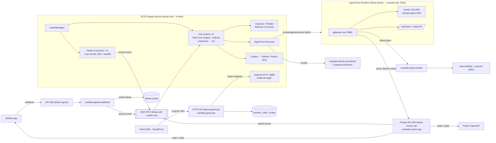

# Design — Super agent on AWS

Status: v1 (2026-11-01). This document is the **single source of truth for cross-module contracts**. A change to §4 must be recorded in §8. The panel self-service onboarding design (contracts v6) is in [`onboarding-design.md`](onboarding-design.md).

## 1. Architecture



Principles:
- **Single writer per cell.** One Engine owns one SQLite file at a time, guaranteed by a DynamoDB lease with fencing. Every write to a cell (triggers, worker events, admin commands) enters through that cell's FIFO queue or that cell's internal HTTP endpoint, both served by the lease owner.
- **DSH core is reused verbatim.** `packages/core` is a copy of `src/core` and `policy.ts`; changes are allowed only in adapters.
- **The worker is untrusted.** Its only authority is the ticket token. Everything it can reach is scoped to (tenant, cell, ticket).
- **Two worker types (v7).** A second AgentCore runtime `dshsa_worker_codex` (same role, VPC, lifecycle and gateway) runs OpenAI `codex app-server` 0.166.0 on Bedrock (`amazon-bedrock-runtime` provider, execution-role SigV4). It is built from the same Dockerfile (target `codex`) and is off with `-c dshsa:codexWorker=false`. A cell chooses the type for new tickets (§4.11).

## 2. Repository layout

See the README's repository layout section.

## 3. AWS environment

- One AWS account per installation (pinned with `DSHSA_ACCOUNT`), region **`ap-northeast-1`** (closer to open.feishu.cn). A dedicated `dshsa-vpc` with **1 NAT gateway** (or import an existing VPC with `DSHSA_VPC_ID`).
- Every resource name and stack name has the prefix `dshsa-`. Stacks: `dshsa-shared`, `dshsa-worker`, `dshsa-host`, `dshsa-ingress`, `dshsa-panel`.
- Models (Bedrock, `global.*` cross-region inference profiles; v7 catalog in §4.11): Assessor/Replier default `global.openai.gpt-6-luna` (effort low); Claude worker default `global.anthropic.claude-opus-5-5`; Codex worker default `global.openai.gpt-6.1-terra` (effort high). Worker type, every role's model and its reasoning effort are set per cell in the panel.

## 4. Contracts (v1–v7)

All TS shapes live in `packages/contracts/src/*.ts` as zod schemas, and a Python mirror lives in `packages/contracts/python/dshsa_contracts.py`. Field names are camelCase on the wire.

### 4.1 Identifiers

| Name | Format | Example |
|---|---|---|
| `tenantId` | `^[a-z][a-z0-9-]{2,30}$`, assigned at onboarding | `acme` |
| `cellId` | `${tenantId}--gh${githubRepoId}` | `acme--gh812345` |
| `ticketId` | DSH core ticket id (opaque string) | — |
| `ticketKey` | `sha256(cellId + "/" + ticketId)` hex, first 32 chars | — |
| `runtimeSessionId` | `"dshsa-" + sha256(cellId + "/" + ticketId)` hex (70 chars, satisfies AgentCore ≥33) | — |
| AP root path | `/tenants/${tenantId}/${cellId}/${ticketKey}` (v4: S3 Files allows ≤ 4 path components) | — |
| Cell queue | `dshsa-cell-${cellId}.fifo` | — |

### 4.2 DynamoDB tables (created by `dshsa-shared`, on-demand, PITR on)

| Table | Key | Attributes | Writers → Readers |
|---|---|---|---|
| `dshsa-tenants` | `tenantId` | `name, cognitoGroup, status(active/disabled), feishu?{domain:'feishu'\|'lark', appId, secretArn}, createdAt` | admin CLI → all |
| `dshsa-cells` | `cellId` | `tenantId (GSI byTenant), repo{owner,name,id,installationId,defaultBranch}, queueUrl, status, stateBucketPrefix, createdAt` | admin CLI → host, ingress, panel-api |
| `dshsa-routes` | `routeKey` (GSI `byTenant` on `tenantId`) | `tenantId, cellId, chatName?, updatedAt, updatedBy`. `routeKey` = `gh#${installationId}#${repoId}` or `fs#${tenantId}#${chatId}`. Binding a Feishu chat also adds it to the cell's Feishu `chats` setting (via internal HTTP), otherwise `scope()` refuses it | admin CLI, panel-api (chat bind) → ingress, connector |
| `dshsa-leases` | `leaseKey` | `owner(taskId), endpoint("http://ip:8080"), fence(number, +1 per acquisition), expiresAt(epoch ms)`. `leaseKey` = `cell#${cellId}` or `connector#${tenantId}` | host → host, panel-api |
| `dshsa-ticket-storage` | `ticketKey` | `tenantId, cellId, ticketId, runtimeSessionId, fileSystemId, accessPointId, rootPath, posixUid=1000, posixGid=1000, status(active/disabled/deleted), createdAt` | provisioner → broker (GetItem only) |

Lease protocol: TTL 30 s, renewed every 10 s with a conditional `owner = me AND fence = f`. If a renewal fails or the expiry is near, the holder **stops the cell before** the expiry (it stops consuming, stops writing, and closes SQLite). An acquirer takes over only an expired lease and sets `fence = fence + 1`. The Litestream restore runs after acquisition.

### 4.3 Ticket token

A JWS compact token, `alg=ES256`, signed with the KMS asymmetric key `alias/dshsa-ticket-token` (ECC_NIST_P256, SIGN_VERIFY), header `kid` = key id.
Claims: `iss="dshsa-cp"`, `aud="dshsa-worker"`, `sub=ticketKey`, `tid=tenantId`, `cid=cellId`, `tkt=ticketId`, `asg=assignmentId`, `rsid=runtimeSessionId`, `iat`, `exp` (≤ iat + 2h), `jti`.
- Only the cell issues tokens, attaching a fresh one to every `start` and `deliver` invocation.
- Verifiers (broker, worker-api) check the signature with the cached KMS public key, plus `iss`, `aud`, `exp` (60 s skew) and that the `ticket-storage` item is `active`.
- Refresh: `POST /v1/token/refresh` on worker-api. worker-api forwards it synchronously to the owning cell's `POST /{cellId}/worker/token-refresh` (internal HTTP, v3 presigned-STS caller auth). The cell issues a new token only while the assignment is `running`.
- The token lives **only in the gateway process (root)**. The agent reaches the control plane through the gateway's local proxy `http://127.0.0.1:8090/cp/*`, and the gateway injects the Bearer header.

### 4.4 Cell → worker: InvokeAgentRuntime payload

`POST /invocations` (AgentCore, SigV4, `runtimeSessionId` from §4.1). Request:
```json
{ "v": 1, "action": "start" | "deliver" | "stop" | "status",
  "token": "<ticket token>",
  "ticket": { "tenantId": "", "cellId": "", "ticketId": "", "assignmentId": "", "title": "", "scope": "", "mandate": {}, "note": "" },
  "inputs": [ { "id": "", "kind": "trigger|policy|resume|text", "at": "ISO", "text": "", "source": "github|feishu", "url": "", "meta": {} } ],
  "config": { "model": "", "systemPrompt": "", "skills": [ { "name": "", "content": "" } ], "env": { "KEY": "VALUE" },
              "repo": { "fullName": "owner/name", "defaultBranch": "main", "cloneUrl": "" } } }
```
Response: always HTTP 200 (AgentCore turns any other status into 424 and drops the body):
`{ "ok": true, "accepted": ["<inputId>"], "state": "idle|running|stopped" }` or `{ "ok": false, "error": "<code>", "message": "" }`.
Semantics:
- `start` is idempotent per assignmentId. It mounts the AP, prepares the repo on the first run, resumes the agent transcript if one exists, and runs the agent **asynchronously**; `/ping` reports `HealthyBusy` while it runs.
- `deliver` queues inputs by `id` and deduplicates them; the agent picks them up at its next step boundary.
- `stop` cancels the current turn and keeps the inbox.
- `status` returns the state without side effects.
- `config` is sent on `start` and on every `deliver`, because prompts may change between turns.

**Worker handling (v7).** The gateway rejects `config.agent` ≠ its image's type (`DSHSA_AGENT`) with `bad_request`, after token verification and before any side effect; an absent `agent` is accepted. The agent reads `config.model`/`config.effort` from config.json at every turn. Claude passes `effort` to the Agent SDK only when it is one of low|medium|high|xhigh|max, and an absent or unknown value means the model default (an unknown value is logged as `effort_ignored`, never an error). `$CONFIG_DIR/skills` holds exactly `config.skills` (others are removed on start/deliver). A turn that fails for a passing reason before its prompt reached the agent is retried with the same inputs, not just "continue".

**Cold start (platform V2).** The platform is expected, but not yet verified on a live runtime, to drop the page cache before it snapshots a ready microVM; AWS documents only that the snapshot is taken once `/ping` is healthy. If it does, a fresh session's first request cold-reads from the lazily loaded snapshot disk: the first mount reads the mount helper, `efs-proxy`, botocore and their libraries, and the first turn reads the Agent SDK's modules and the ~313 MB Claude CLI binary the SDK spawns. The gateway therefore starts `pinner.py` before it listens on :8080. The pinner maps the files listed by the image's build-time probe (`pin_manifest.py`: the mount's files first, then the first turn's, with the CLI last; only root-owned files nobody else can write, outside the agent's writable trees) so they stay in the snapshot. It pins at most `PIN_MAX_BYTES` (default 512 MB; about 466 MB are listed) within 20 s, in manifest order, so a lower cap drops the CLI before any mount file. The gateway kills the pinner 10 s after the agent's `/status` first reports `cliStarted` (the first turn has had a message from the CLI), or 120 s after the first mount, whichever comes first. This is best effort: a missing manifest or any pinner failure only logs a warning. To check it on a deploy, compare against the previous image a fresh session's first `mounted` line (`mount_ms`; 14–35 s unpinned, 2.0–2.7 s with the mount set pinned) and its first `cli_started` line with `first: true` (`ms` from before the SDK connects to the first CLI message, and `connect_ms`). Then read the `pinned` line (`files`, `bytes`, `pin_ms`, `wait_ms`, `max_bytes`) and the `pin_released` line's `reason`.

### 4.5 Worker → control plane: worker-api (private API GW, Bearer ticket token)

| Route | Body | Result | Semantics |
|---|---|---|---|
| `POST /v1/events` | `WorkerEvent` (below) | `{ok:true}` | Enqueued to the cell queue as a `worker.event` envelope; dedup by `event.id` (a uuid the worker keeps across retries and restarts) |
| `POST /v1/read` | `{ resource: "github/..." \| "feishu/<triggerId>/..." }` | `{ ok, content, mediaType }` | Read-only. The scope is checked against the token (cell repo only; for Feishu only the tenant's bound chats) |
| `POST /v1/credentials/github` | `{}` | `{ token, expiresAt }` | Installation token for the cell's repo with `contents:write, pull_requests:write, issues:write`, ≤1h |
| `POST /v1/token/refresh` | `{}` | `{ token }` | See §4.3 |

`WorkerEvent` = `{ id, ticketKey, assignmentId, at, type, body }`, where `type` ∈
`ack` `{text, triggerId}` · `report` `{state, text, question?: string|null (null clears), askedBy?: triggerId, answers?: triggerId, prNumber?: number|null, links?}` · `handback` `{triggerIds[], reason}` · `thread.follow` / `thread.unrelated` `{thread: "<source>:<id>" (DSH thread key), reason}` · `inputs.read` `{inputIds[]}` · `turn.ended` `{reason}` · `token.refresh` `{}`.
These map 1:1 to the DSH worker tools (`orchestrator_ack`, `orchestrator_report`, `orchestrator_trigger_handback`, `orchestrator_thread_follow`, `orchestrator_thread_unrelated`) and to the Executor callbacks (`inputsRead`, `turnEnded`).

### 4.6 Cell queue envelope (SQS FIFO, one queue per cell)

`MessageGroupId = cellId`, `MessageDeduplicationId = envelope.id`.
```json
{ "v": 1, "id": "", "cellId": "", "type": "source.event" | "worker.event" | "admin.command", "at": "ISO", "body": {} }
```
- `source.event` body: `{ source: "github"|"feishu", kind: "<webhook event name or im.message.receive_v1>", deliveryId: "", payload: {} }`. The payload is raw, as GitHub/Feishu sent it (already verified by ingress). The cell's SourceKind (`packages/sources`) normalizes it into a DSH Trigger with deterministic ids, so duplicates from webhook + reconcile + backfill collapse.
- `worker.event` body: `WorkerEvent` (§4.5) plus `verified: {tid, cid, tkt, asg}` from the token.
- `admin.command` body: `{ command: "", args: {}, requestId: "", actor: { sub, email } }`. Reserved; panel writes use internal HTTP (§4.7).

### 4.7 Internal HTTP (host task, VPC only, port 8080) — v3: IAM caller auth

`/{cellId}/api/*` reuses DSH `src/app/api.ts` routes and payloads (panel-api only). `/{cellId}/worker/*` serves worker-api: `token-refresh` (§4.3) and `read` (`feishu/...` resources, so Feishu reads use the cell's TS readers and tenant credentials and are never ported to Python).

**Auth (replaces the v1/v2 shared-secret header, per builder-security):** the caller proves its IAM identity with a **presigned `sts:GetCallerIdentity` request**, the same scheme Vault and aws-iam-authenticator use.
- Header `x-dshsa-caller`: a presigned URL for `https://sts.ap-northeast-1.amazonaws.com/?Action=GetCallerIdentity&Version=2011-06-15` with SigV4 query auth, `X-Amz-Expires=60`, and the extra signed header `x-dshsa-target: <cellId>` (included in `X-Amz-SignedHeaders`).
- Host: it rejects a URL whose host is not the regional STS endpoint, whose action is not exactly GetCallerIdentity, or that doesn't sign `x-dshsa-target`. It then GETs the URL (adding `x-dshsa-target` = the path's cellId), takes the `Arn` from the response, and requires it to match an allowed role (`assumed-role/<panel-api role name>/*` for `/api/*`, `assumed-role/<worker-api role name>/*` for `/worker/*`; the role names come from env). It caches the result by sha256(URL) until expiry. A failure returns 401.
- The SG allowlist (panel-api SG and worker-api SG → host:8080) stays as a second layer. VPC Lattice was considered and rejected for phase 1, because requests must reach the specific lease-owner task.

panel-api resolves the owner endpoint from `dshsa-leases`; a missing or expired lease (`expiresAt <= now`) → 503 `cell_unavailable`. The original `origin: 'panel'` guard becomes `origin: 'panel', actor: {sub, email}`.

### 4.8 Feishu Connector interface (implemented in `packages/sources`, hosted by `packages/cell`)

```ts
interface Connector { readonly key: string /* connector#tenantId */; start(ctx: ConnectorContext): Promise<void>; stop(): Promise<void> }
interface ConnectorContext { tenant: TenantRecord; secrets: { appId: string; appSecret: string; encryptKey?: string };
  route(chatId: string): Promise<string | undefined> /* cellId */; enqueue(cellId: string, env: CellEnvelope): Promise<void>;
  kv: { get(k: string): Promise<string|undefined>; put(k: string, v: string): Promise<void> } /* cursors, in dshsa-leases-adjacent table or S3 */;
  log: Logger; signal: AbortSignal }
```
The host acquires `connector#tenantId` leases exactly like cell leases. Cursor KV: stored as an S3 object `s3://dshsa-state-<acct>/connectors/<tenantId>/kv.json`, written only by the lease owner.

### 4.9 S3 buckets

- `dshsa-data-<acct>`: S3 Files data bucket. Only the S3 Files service role can access it.
- `dshsa-state-<acct>`: Litestream replicas `cells/<cellId>/`, connector KV, panel view caches. Only the host role can access it.
- `dshsa-panel-<acct>`: SPA, behind CloudFront OAC.

### 4.10 Worker file layout — v5 (after spike S1)

S1 (Django, 7k files, real microVM, ap-northeast-1) measured git on the S3 Files mount at 17–384× slower than local disk: clone 138 s vs 8 s, warm status 3.2 s vs 0.17 s, grep 11 s vs 0.04 s, small-file writes 23 s vs 0.06 s. The hot working copy therefore lives on **local disk**. S3 Files keeps only durable, small or append-only state, plus one sequential bundle file.

```
/home/agent/work/repo/            LOCAL (microVM disk): the git working copy the agent edits; lost with the VM
/mnt/work/.claude/                S3 Files: Claude Agent SDK config + session transcripts (append-only JSONL), for resume
/mnt/work/.dshsa/                 S3 Files: inbox.jsonl, state.json, config.json (fsync'd)
/mnt/work/repo.bundle             S3 Files: `git bundle create --all` of the local repo, plus refs/dshsa/wip
/mnt/work/out/                    S3 Files: artifacts the worker wants to keep
```
- **Codex tickets (v7)** keep only their rollouts on the AP: `/mnt/work/.codex/sessions/YYYY/MM/DD/rollout-*.jsonl`, linked as `$CODEX_HOME/sessions`. CODEX_HOME itself (`/home/agent/.codex`: config, skills, writer locks, helper links) and Codex's SQLite are on the VM's local disk, because codex's per-thread file lock would outlive a stopped VM on S3 Files (NFS lease; found live 2026-11-03). `state.json` stores `codexThreadId/Path/At`, `codexTurnAt` and `codexPromptHash`, and a fresh VM resumes with `thread/resume`; a changed cell prompt reaches a resumed thread once as an `application` `additionalContext` note (codex sends `developerInstructions` only at thread start). Only the cell's skills (given YAML frontmatter when they lack it) plus the repo's `.agents/skills` are visible; bundled, user and admin skills are removed, and codex's guardian reviewer is off. The app-server inherits the agent environment minus `AWS_BEARER_TOKEN_BEDROCK`, `AWS_PROFILE`, `AWS_CONFIG_FILE`, `AWS_SHARED_CREDENTIALS_FILE`, `OPENAI_*` and `CODEX_*`, and starts on the first turn (after the V2 restore, so with session credentials).
- **Checkpoint** (agent, at the end of every turn and on gateway SIGTERM, before `turn.ended`): commit uncommitted changes to `refs/dshsa/wip` without touching the branch (`git stash create` → `update-ref`); then `git bundle create /mnt/work/repo.bundle.tmp --all` → fsync → atomic rename to `repo.bundle`; then `sync()`.
- **Bundle is incremental** (v5.1): `git bundle create --all --not --remotes=origin` holds only what GitHub doesn't have (local commits, local branches, `refs/dshsa/wip` = work tree incl. untracked, `refs/dshsa/wip-index` = index). A full bundle would force a blob:none partial clone to lazily fetch every historical blob.
- **Prepare/resume** (agent, on start in a fresh VM): `--filter=blob:none` partial clone from GitHub, then (if `repo.bundle` exists) fetch the bundle's refs, check out the recorded branch, `read-tree -m -u HEAD wip`, then `read-tree wip-index`, then `fetch origin`. If a force-push on origin dropped the bundle's prerequisite commits, the restore fails closed (report `failed`).
- Pushing to GitHub (the PR branch) is still the real durability path for finished work; the bundle covers unpushed WIP between microVMs.
- Export from S3 Files to S3 objects lags (61.8 s measured). The panel transcript is therefore near-real-time (~1 min), and the UI says so.

#### How each file reaches durable storage

There is no sync code for anything under `/mnt/work`: it is an NFS mount of the ticket's AP, so a write that the kernel has flushed to the mount is on S3 Files. Only the git working copy needs explicit copying.

| File | Writer | How it is written | Durable when | Read back by |
|---|---|---|---|---|
| `.claude/projects/<cwd>/<sdkSessionId>.jsonl` | Claude CLI (spawned by the Agent SDK with `CLAUDE_CONFIG_DIR=/mnt/work/.claude`) | The CLI appends one JSON line per message, tool call and result | Each line, as the CLI writes it; `os.sync()` at turn end before `turn.ended` | the agent on the next turn (`resume`); panel-api via the S3 export |
| `.claude/skills/…`, CLI user config | agent (`write_skills`) on `start`/`nudge`; the CLI | Rewritten whole | On write | the CLI |
| `.dshsa/inbox.jsonl` | gateway (`Store.append` on `start`/`deliver`, under `flock` on `inbox.lock`) | Append + `fsync`, deduplicated by input id | Before `deliver` returns `accepted` | the agent (`unread`) |
| `.dshsa/config.json` | gateway (`save_config` on `start`/`deliver`) | Write `*.tmp` → `fsync` → `os.replace` | On write | the agent (`sdk_runner`, `nudge`) |
| `.dshsa/state.json` | agent (`mark_read` adds the read input ids; `update_state` sets turn start/end and `clean`), under the same lock | Write `*.tmp` → `fsync` → `os.replace` | On write | gateway and agent |
| `repo.bundle` | agent (`Repo.checkpoint`) | Built on local disk, copied in one sequential write to `repo.bundle.tmp` → `fsync` → `os.replace` → directory `fsync` | At turn end (before `turn.ended`) and on gateway SIGTERM (`/checkpoint`, 25 s budget) | `Repo.prepare` on a fresh VM |
| `/home/agent/work/repo` | agent, git | Local disk | Never on its own; only through `repo.bundle` and pushes to GitHub | — |

- **Claude session id and resume.** The SDK session id is derived, never stored: `sdk_session_id(ticketKey) = uuid5(ns, "dshsa/" + ticketKey)`. Before each turn, `sdk_runner` checks whether `projects/*/<id>.jsonl` exists (`Worker.session_exists`). If it does, the SDK gets `resume=<id>`; otherwise it gets `session_id=<id>`. A fresh microVM on the same runtimeSessionId mounts the same AP, so the CLI resumes from the same file (spike S2).
- **Loss window.** If a microVM dies mid-turn, the transcript, inbox and state keep everything up to the last line written. What is lost is the working-copy change made since the last checkpoint, which normally means the current turn's uncommitted edits.
- **Panel transcript.** S3 Files exports the AP tree to `dshsa-data` at `tenants/<tenantId>/<cellId>/<ticketKey>/.claude/projects/` (~60 s lag). `packages/control-api/src/transcript.ts` lists that prefix, picks the newest `.jsonl` and reads its tail with a ranged GET.

#### Alternative evaluated: AgentCore session context keys (2026-11-03, not adopted)

On platform V2, AgentCore adds `aws:AgentCoreRuntimeSourceSid` (= runtimeSessionId) to each session's execution-role credentials. An execution-role policy can therefore scope each session to `s3://…/sessions/${aws:AgentCoreRuntimeSourceSid}/*` with no broker or provisioner ([runtime-sessions](https://docs.aws.amazon.com/bedrock-agentcore/latest/devguide/runtime-sessions.html#runtime-session-isolation), [runtime-fuse-mounts](https://docs.aws.amazon.com/bedrock-agentcore/latest/devguide/runtime-fuse-mounts.html)). Our runtimeSessionId (`dshsa-` + 64 hex) already meets the required `^[A-Za-z0-9_-]{33,256}$`. We kept the AP + broker design because:
- **The keys can't scope S3 Files.** `s3files:ClientMount`/`ClientWrite` authorize only on the file-system resource. The only per-mount condition is `s3files:AccessPointArn`, and an AP's id is random, so no policy can map a session id to its AP. Adopting the keys means leaving S3 Files for a plain S3 prefix.
- **A plain prefix can't hold the files above as they are written today.** Mountpoint for S3 on a general-purpose bucket supports neither append nor rename. The CLI's JSONL transcript and `inbox.jsonl` append, and `state.json`/`repo.bundle` rely on `os.replace`. Those files would have to live on local disk, with the gateway uploading them. Durability would drop from per-line to per-upload, and a mid-turn VM loss would cut the transcript.
- **The other options in that doc fit worse.** A loopback ext4 image is persisted only as a whole-image upload, and panel-api couldn't read the transcript inside it. Self-mounted NFS is what we do now, with the same IAM limitation.
- **Managed session storage (Preview) is not durable across deploys.** It is reset on every runtime version update and after 14 days idle.
- **The AP design is stronger on isolation.** The execution role has no storage permissions, the mount credentials are root-only and minted against a KMS-signed ticket token, and `disable` revokes future mounts.

What switching would buy: no `dshsa-provisioner`/`dshsa-broker`/`dshsa-ticket-storage`, no S3 Files file system, mount targets or NFS SG, no mount on cold start, and panel lag of seconds instead of ~60 s. Revisit if S3 Files gains a path or tag condition that can use the session key, or if the CLI's transcript can be redirected to an object store.

Git performance does not depend on this choice: both designs keep the working copy on local disk. If restoring on a fresh VM (partial clone + bundle) becomes the bottleneck, consider a loopback ext4 working copy uploaded as a single object on SIGTERM/idle. That would carry dependencies and build caches across VMs, while `repo.bundle` stays the per-turn checkpoint.

### 4.11 Models and worker types — v7

The catalog lives in `packages/contracts/src/models.ts` (`MODEL_CATALOG`, mirrored in `dshsa_contracts.py`; `tests/vectors.json` `models` is the oracle). Each model lists the **surfaces** it serves (`converse` = Assessor/Replier, `claude-worker`, `codex-worker`) and per surface the efforts it accepts, an optional `defaultEffort`, and Converse capability flags.

| Model | converse | claude-worker | codex-worker |
|---|---|---|---|
| `global.anthropic.claude-opus-5-5` | — | low…max | — |
| `global.anthropic.claude-sonnet-5-5` | low…max; cache point | low…max | — |
| `global.anthropic.claude-haiku-5-5` | low…max; forced tool; cache point | low…max | — |
| `global.openai.gpt-6-astra` | — | — | low…max |
| `global.openai.gpt-6.1-sol` | — | — | low…max |
| `global.openai.gpt-6.1-terra` | none…max; forced tool; cache point | — | low…max, default **high** |
| `global.openai.gpt-6-luna` | none…max, default **low**; forced tool; **no** cache point | — | — |

- **Settings** (`packages/core/src/policy.ts`): `eval.model` (Assessor), `eval.replyModel` (Replier; null → `eval.model`), `executor.workerType` (`claude` | `codex`, default `claude`), `executor.model` (for that type). A RoleModel is `{ provider: 'bedrock', model, reasoningEffort? }`.
- **Resolution** (`resolveModel(role, settings, workerType?)`): stored model, else the catalog default. Effort = the stored one if the surface lists it, else the surface's `defaultEffort`, else **none is sent** (the model's or CLI's own default — so Opus/Sonnet behave as before v7). A stored id outside the catalog (pre-v7) is used as-is without effort; it is never replaced silently.
- **Save validation** (`Settings.save`): a RoleModel is checked against the catalog only when it changed; switching `workerType` re-checks the worker model and is refused when this host has no runtime for the new type. Error `modelUnavailable` with values `{ block, field: model|replyModel|workerType, reason: unknownModel|wrongSurface|badEffort|workerUnavailable, error }`.
- **Rollback safety:** the settings schemas are strict, so v7 keys are persisted only when they differ from their default (`withoutV7Defaults`); a cell that never used them stays readable by a pre-v7 host. A cell that did needs those revisions reverted before a host rollback below v7.
- **`GET models`** returns `{ models: MODEL_CATALOG, defaults: DEFAULT_MODELS, workerTypes: [{ id, label, available }] }`; the panel builds every picker from it.
- **Converse request per model** (`packages/assess/src/model.ts` `converseShape`): forced `toolChoice: { tool }` only where `forceTool` (Claude Sonnet/Opus 5.5 refuse it; the user turn's must-call instruction stays for every model), the cache point only where `promptCache` (GPT-6 Luna refuses it and caches implicitly), effort in `additionalModelRequestFields.output_config.effort` (Claude) or `.reasoning.effort` (GPT). Never `temperature`/`topP`/`stopSequences` (GPT-6 rejects them). Live-verified 2026-11-03 for all four converse models.
- **Worker invocation:** `WorkerConfig` gains `effort?` (omitted when none is sent) and `agent?` (the ticket's worker type). `validate_invocation` only type-checks them: a worker drops and logs an effort it does not know, while an `agent` ≠ its own type is `bad_request`. `config` goes with every `start`/`deliver`, so model/effort changes apply from a ticket's next turn.
- **Sticky worker type:** cell KV `worker-type:<ticketId>` is written if absent before the first invoke of a ticket's first launch; a ticket that started before v7 is `claude`. The executor holds one runtime per type (`RUNTIME_ARN`, optional `RUNTIME_ARN_CODEX`) and reads each type's served version from `WorkerVersion.parameters[type]` (`/dshsa-worker/version`, `/dshsa-worker-codex/version`). A ticket whose type has no runtime fails permanently ("… worker is not deployed in this installation").
- **Transcript:** control-api reads the newest of `<apRoot>/.claude/projects/**.jsonl` and `<apRoot>/.codex/sessions/**/rollout-*.jsonl` and returns `agent` with the raw entries; the panel renders each format. A denied `.codex/sessions/` listing is treated as empty (the grant may deploy after the code).

## 5. Security model (delta from the reference)

| Layer | Mechanism |
|---|---|
| Runtime entry | AgentCore inbound auth = IAM. Only the `dshsa-host` task role has `bedrock-agentcore:InvokeAgentRuntime`; **nobody** has `InvokeAgentRuntimeCommand`, which closes the root-via-JWT path the reference documents |
| Ticket identity | KMS-signed ticket token (§4.3). It stands in for the reference's Cognito JWT, because the cell, not a browser, starts the worker |
| Storage | Session policy `s3files:AccessPointArn == ticket AP`; FS policy denies non-AP Client*; execution role has zero S3/S3 Files permissions; `nodirects3read` (all as in the reference) |
| VM | gateway root, agent uid 1000 + NoNewPrivs; one VM is bound to one ticketKey (the first token's `sub`) |
| Worker egress | worker-api is a private AWS_IAM API (runtime role + `aws:SourceVpce`) and also requires the ticket token in `x-dshsa-ticket-token`; scopes come from the token, never from the request; the gateway's CP proxy strips agent-set `x-dshsa-*` headers |
| Panel | Cognito JWT → panel-api checks that the user's `cognito:groups` contains the cell's tenant `cognitoGroup` → internal HTTP |
| Ingress | GitHub webhook HMAC (`X-Hub-Signature-256`) with the secret in Secrets Manager; API GW throttling. Feishu needs no public endpoint (long connection) |

## 6. Key flows

1. **Mention → ticket**: webhook → route → cell queue → `sources` normalizes → Engine.receive → gate → Assessor (Bedrock) → accept → effects: provisioner(createAP) → mint token → InvokeAgentRuntime start → worker `ack` → Outbox comment.
2. **Follow-up**: Trigger fan-out to the subscribed ticket → Executor.deliver → InvokeAgentRuntime deliver (new token) → `inputs.read` event.
3. **Resume after microVM loss**: deliver/start on the same runtimeSessionId → AgentCore provisions a new VM → the gateway mounts the same AP → the agent resumes from `/mnt/work/.claude` + `state.json`.
4. **Report**: worker `report ready` → worker-api → cell queue → Engine.report → Replier (Bedrock) composes the reply → Outbox → GitHub/Feishu.

## 7. Risks and spikes

- S1: git clone/status/commit performance of a mid-size repo on S3 Files vs local disk + sync.
- S2: Claude Agent SDK session resume from a transcript on S3 Files in a fresh microVM (same runtimeSessionId after a forced stop).
- S3: stability and latency of the Feishu and Lark long connection from us-west-2 (≥30 min soak, reconnect behaviour).
Each produces `spikes/S<n>-*.md` with numbers and a recommendation. A result that changes §4.10 or §4.4 → update this document.

## 8. Contract change log

- v1 2026-11-01: initial.
- v2 2026-11-01: region → ap-northeast-1; routes get `byTenant` GSI + tenantId/chatName/updatedAt/updatedBy; WorkerEvent ack.triggerId (required), report question|null/askedBy/answers/prNumber, thread events carry reason; Cognito groups `dshsa-tenant-<id>` + `dshsa-platform-admin`; Claude Agent SDK session id = uuid5(ns, "dshsa/"+ticketKey) (`sdk_session_id`).
- v3 2026-11-01: §4.7 internal HTTP auth = presigned sts:GetCallerIdentity (`x-dshsa-caller`, signed `x-dshsa-target`), replacing the shared-secret header; adds `/{cellId}/worker/read` for Feishu reads. worker-api is AWS_IAM private API (runtime role + aws:SourceVpce), and the ticket token travels in `X-Dshsa-Ticket-Token`.
- v4 2026-11-01: AP root path → `/tenants/<tenantId>/<cellId>/<ticketKey>`, because CreateAccessPoint rejects more than 4 components (found on the first real deploy). Added `ticketDataPrefix()` and `MAX_AP_PATH_COMPONENTS`.
- v5 2026-11-01: §4.10 working copy on local disk + `repo.bundle` checkpoint on S3 Files (spike S1 numbers); export lag ~60 s documented.
- Decisions (not contract): cell Store uses Node built-in `node:sqlite` (DSH Store verbatim) instead of better-sqlite3. Panel/view types are exported type-only by `@dshsa/cell` (`@dshsa/cell/api-types`), not by contracts. Transcript viewer: panel-api gets read-only S3 on `dshsa-data` restricted to `tenants/*/*/*/.claude/*` (v4 layout), after the tenant authz check. The internal API uses v3 presigned-STS caller auth plus the SG allowlist; the v1 shared-secret header is removed.

- **v6 (2026-11-01, panel self-service onboarding)**: tenant admin group `dshsa-tadmin-<t>`, `PanelRole` +
  `x-dshsa-role`, `RESERVED_TENANT_IDS`, table `dshsa-onboarding` (`onboardingKey.githubInstall/githubState`,
  `InstallationClaim`, `SetupState`), `TenantRecord.feishu.revision`, secret `dshsa/github-oauth`
  (`GithubOauthSecret`), `AuditEntry` + `/dshsa/panel-admin`. Full design: `onboarding-design.md`.
- **v6.1**: `leaseKey.host(owner)` / `HOST_LEASE_PREFIX` — per-task presence lease for endpoint discovery of
  tenant-level host routes; `LeaseRecord.leaseKey` accepts `host#`.
- **v6.2**: `GithubOauthSecret` gains optional `appId`/`slug` (mirrored by app-set); `InstallationClaim` gains
  required `status: active|pending`, `account`, `accountType`, `githubLogin`, optional `pendingReason`,
  `approvedBy/At` — org installs need an org admin or platform approval.
- **Not contract (2026-11-01, ignored requests)**: cell setting `eval.replyOnIgnore: boolean` (zod default `true`, so stored
  settings parse; outside the Policy version). Cell view `DecisionView` gains optional `source` and `sender` (panel
  "Recently ignored", `GET decisions?kind=ignore&window=24h`). Host log line `decision ignored`
  `{cellId, decisionId, triggerIds, strength, codes, source, actor}` for every ignore the gate did not record. Cell KV
  family `ignore-hint:<threadKey>` holds the last hint time (one hint per Thread per 10 min, message id
  `key('ignore-hint', triggerId)`).
- **v7 (2026-11-03, model choice + Codex worker)**: §4.11 model catalog (`models.ts`), settings `eval.replyModel` / `executor.workerType`, `WorkerConfig.effort` / `agent`, `WorkerVersion.parameters`, `GET models` = `ModelCatalogView`, KV `worker-type:`, transcript `agent`. Defaults: Assessor/Replier GPT-6 Luna (low), Claude worker Opus 5.5, Codex worker GPT-6.1 Terra (high). Rollback below v7: revert settings revisions that set `replyModel`/`workerType` first.
- **Not contract (2026-11-03, docs only)**: §4.10 documents how each worker file reaches durable storage and the Claude
  transcript resume path. It also records why AgentCore session context keys (`aws:AgentCoreRuntimeSourceSid`) were
  evaluated and not adopted. No code change.
