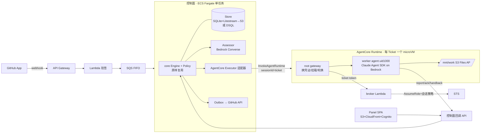

# 00 综合：dsh-superagent → AWS（AgentCore Runtime + S3 Files）方案草案

> 来源：01-core-engine.md、02-app-sources-tools.md、03-panel-deploy-tests.md，以及 agentcore-s3files-per-user-isolation/。
> 状态：**讨论稿**，待决策点见第 5 节，未定稿前不动手。

## 1. DSH 原型一句话

一个 DSH 进程 = 一个团队 + 一个 GitHub 仓库 + 一个 agent 账号。GitHub/Feishu **轮询**产生 Trigger → Thread 内串行 Eval（确定性 gate + 主 Session 里的模型研判）→ accept 生成 Ticket（带不可变 Mandate）→ 每个 Ticket 一个 worker Session + 一个工作目录（git worktree）→ worker 用结构化 report 回报 → 主 Session 回复到原会话（Outbox，按 sink key 幂等）。
状态全在一个 SQLite（单写者文件锁 + 事务内 effect 表 = transactional outbox）。worker 以 `danger-full-access` 跑在 operator 的 OS 用户下，**几乎没有隔离**。

## 2. 可原样复用 vs 必须重写

| 部分 | 处理 | 依据 |
|---|---|---|
| `src/core/*`、`policy.ts`、内容派生 ID、领域测试（core-engine/policy/followups/effects） | **原样复用** | core 只依赖 `node:crypto`（01 §4） |
| `Repositories`（同步 + `atomic()`） | 适配：MVP 保留 SQLite 语义，后期换 DSQL/Aurora | 01 §5/§6a |
| `Executor` 端口（start/deliver/stop + inputsRead/turnEnded 回调） | **重写**为 AgentCore 适配器 | 01 §4、§6c |
| 主 Session（router，14 个 orchestrator_* 工具） | **重写**（见决策 D3） | 01 §6d |
| Sources：GitHub 轮询 | 改为 GitHub App webhook + 对账轮询 | 02 §1 |
| Prompts、skills | 复用文本，换装配器 | 02 §7 |
| Panel（DSH 宿主插件，依赖 @deepseek-ai/dsh-client-ui-*） | **重写**最小 SPA；API 契约（api.ts 25 条路由）可复用 | 03 §1-2 |
| 全部 `@deepseek-ai/*`（cordis、session、llm、workspace、webserver、presets…） | 替换 | 02 §9 |

## 3. 目标架构（草案）

要点：
- **控制面单写者**：保留 DSH「单进程事务原子性」这一核心假设，避免一上来就把 Engine 改成分布式。
- **Worker = AgentCore session per Ticket**：`runtimeSessionId` 由 ticketId 派生。异步执行：invocation 立即返回，后台跑 agent，`/ping` 返回 `HealthyBusy` 保活。新的 Inputs（人追加的消息、Policy 变更）通过对同一 session 的新 invocation 投递，由 worker 内部 inbox 在回合之间注入（替代 DSH 的 steer）。
- **跨 microVM 续命**：AgentCore 的 maxLifetime 上限是 8h（microVM），idle 默认 15 min（已查官方文档）。Ticket 可能持续数天并反复 resume，所以**工作目录和 agent transcript 都放在 S3 Files 挂载上**。新 microVM 起来后从挂载里的 transcript 恢复会话。这正是 S3 Files 在这个方案里的核心价值。
- **身份链**：参考方案里 broker 认的是浏览器带来的 Cognito JWT，这里换成**控制面签发的短期 ticket token**（KMS 签名，即 walkley 方案的票据）。原因是 worker 由控制面调起，不是由终端用户的浏览器调起。broker 按 token 里的 ticket/tenant 查 DynamoDB 映射，再签发会话策略限定的 STS。其余隔离层不变：文件系统策略兜底、执行角色零 S3 权限、agent 降权到 uid 1000 并设 NoNewPrivs、一个 VM 只绑一个 ticket。
- **GitHub 凭证**：控制面按 ticket 铸造 GitHub App installation token（限定仓库、1h），经 gateway 注入给 agent，供 git push 和 gh 使用。agent 能拿到这个 token，所以它的权限就是 token 的 scope。
- **Panel**：最小 SPA（Overview / Execution / Settings），Cognito 登录，API Gateway JWT authorizer 鉴权后访问控制面 API。原型里「只有 panel 能改执行环境」的护栏改由 IAM/Cognito 真正强制执行。

## 4. 主要风险

1. 主 Session 的语义：原型里研判和回复都在一个长生命周期的 LLM 会话里完成，拆成无状态调用后，研判质量需要用原型的 prompts 回归验证。
2. git 在 NFS（S3 Files）上的性能：大仓库 clone 和 status 可能慢。缓解办法是 partial clone，或者在本地盘 clone、只把 `.git` 之外的产物同步到挂载（待验证）。
3. 同一 Ticket 被并发拉起两台 microVM，导致同一挂载双写：需要控制面的槽位和租约来保证单活。
4. V2 快照恢复后首次挂载要 8–38 s（参考方案实测），worker 冷启动会变慢。
5. GitHub App 不能像用户账号那样被 @ 后收到通知，触发方式要改成在 webhook 收到的评论文本里匹配 `@<app-slug>`，行为和原型略有差异。

## 5. 待决策点

- **D1 产品形态**：单团队部署（忠实于原型，一套栈对应一个团队/仓库），还是多租户平台（一套栈服务多个团队/用户，每个租户有自己的仓库、Policy 和 agent）？
- **D2 S3 Files 隔离单位**（= access point 的粒度）：每 Ticket 一个 AP / 每租户一个 AP / 每个发起人（用户）一个 AP。
- **D3 主 Session 形态**：拆成控制面里的无状态 Bedrock 调用（Eval 本就「Holds no state」），还是做成一个常驻的 router AgentCore session？
- **D4 worker agent 框架**：Claude Agent SDK（自带 fs/bash/grep/subagent/todo，最接近 DSH worker 的工具集），还是 Strands Agents（参考方案使用的框架）？
- **D5 Store**：MVP 用 SQLite + Litestream（core 零改动），还是一步到位 Aurora DSQL / DynamoDB（需要把 Repositories 改成异步）？
- **D6 MVP 范围**：只做 GitHub Source + 单租户 + 3 个面板页，Feishu、Trigger 时间线、搜索放到第二期？
- **D7 IaC 与语言**：CDK TypeScript（控制面复用 TS core）+ worker 容器用 Python 或 TS？

## 6. 已确认决策（2026-11-01）

| # | 决策 | 结论 |
|---|---|---|
| D1 | 产品形态 | **多租户平台** |
| D1a | 租户边界 | 租户 = 团队（Cognito group），可以绑定多个 GitHub 仓库；**每个 (tenant, repo) 一套 Policy/prompts 和一个 Engine** |
| D1b | 控制面承载 | **Cell**：每个 (tenant, repo) 一个 Engine + 一个独占的 SQLite，Litestream 同步到 S3；用 DynamoDB 租约保证单写者；core 不改 |
| D1c | GitHub 接入 | **平台统一的一个 GitHub App**；webhook 按 installation+repo 路由到对应 cell；worker 用按仓库限定的 1h installation token |
| D2 | S3 Files 隔离单位 | **每个 Ticket 一个 AP**，根目录 `/tenants/<t>/repos/<r>/tickets/<id>`，posix 1000:1000、0700 |
| D2a | 文件系统分布 | **共享 FS 池 + DynamoDB 映射表**（ticket → fsId/apId），快满时扩一个 FS |
| D3 | 主 Session | **控制面内的无状态 Bedrock Converse 调用**（Eval 研判和回复撰写各是一次调用），上下文从 Store 重建 |
| D4 | Worker 框架 | **Claude Agent SDK on Bedrock**，运行在 AgentCore Runtime 里，每个 Ticket 一个 session |

### 由决策推出的设计调整
- **租户开户**（替代参考方案里的 manage_users.py）：管理 API/CLI 负责建租户、建 Cognito group、登记 GitHub App installation、创建 cell 配置。Ticket 的 AP 不在开户时创建，而是在 **accept 时**由该 cell 的 Engine 通过一个专门的 provisioner Lambda 创建，Engine 本身不持有 S3 Files 控制面权限。
- **broker 认的凭据**：控制面用 KMS 签发 ticket token（内容为 tenant/repo/ticket/exp）。broker 验签后查映射表，签发只能挂这一个 AP 的 STS。这里不使用终端用户的 JWT，因为 worker 由控制面调起，而不是由浏览器调起。
- **Runtime 鉴权改为 IAM（SigV4）**：只有控制面角色能调用 `InvokeAgentRuntime`，终端用户不能直接访问 runtime。这样也就关掉了参考方案指出的「用户 JWT 可以调用 `InvokeAgentRuntimeCommand` 拿到 root」这个口子。
- **Cell 调度**：MVP 用一个 Fargate service，每个 task 托管多个 cell，cell 的分配靠 DynamoDB 租约。webhook 先进 SQS（按 cell 设 MessageGroupId），由持有租约的 task 消费。
- **Panel**：通过 Cognito 登录，group 决定能访问哪些租户，API 只能访问本租户的 cell。

## 7. 飞书接入（第一期，2026-11-01 确认）

| # | 决策 | 结论 |
|---|---|---|
| F1 | 应用模式 | **每个租户一个自建应用 bot**；app_id/secret/encrypt_key 存 Secrets Manager，按租户隔离 |
| F2 | 入站 | **长连接（WebSocket）+ 每 60s 补收**，跑在控制面 Fargate 里，不开公网入口 |
| F3 | 路由 | **群绑定仓库**：租户只有一个 bot，每个群在面板里绑到一个 (tenant, repo) cell；没绑定的群里的消息只记录、不处理 |
| F4 | 站点 | **飞书和 Lark 都支持**：租户自己配置 domain（open.feishu.cn / open.larksuite.com） |

### 推导出的设计
- **租户级 Feishu Connector**：飞书长连接是集群模式，同一个应用的多条连接之间不广播事件，所以每个租户只开**一个**连接，放在一个租户级 connector 里（和 cell 一样靠 DynamoDB 租约保证单活）。connector 负责长连接、补收游标和群名刷新，按 chat→cell 绑定表把消息转成 Trigger，投进**和 GitHub webhook 同一条 SQS FIFO**（MessageGroupId = cell）。cell 侧只看到统一的 Trigger，Engine 内部的 Source 语义（确定性 ID `key('feishu', message_id)`、Thread key `feishu:<chat>:<root|msg>`）保持不变。
- **出站**：cell 的 Outbox 用租户 bot 的 tenant_access_token 调 OpenAPI 回复，沿用 `--idempotency-key = message.id` 的幂等做法。
- **worker 拿不到飞书凭据**：worker 读飞书原文、图片一律通过控制面工具（`orchestrator_read feishu/...`）。原型里给 worker 放的 lark-cli shim 去掉。这一条比原型更严格。
- **Policy**：飞书 allowed list 按 open_id 记录，挂在租户 + cell 上。原型「跨 Source 的身份不互相映射」的原则保持不变。
- **风险**：海外区域访问 open.feishu.cn 是跨境访问，长连接的稳定性和延迟需要在 spike 里实测；断线时靠补收兜底（原型已有）。
