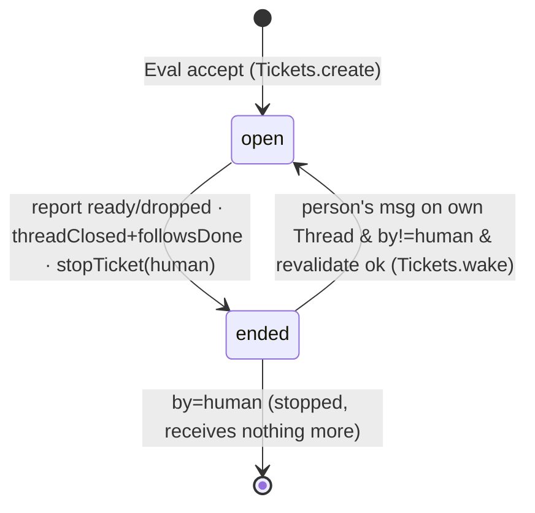
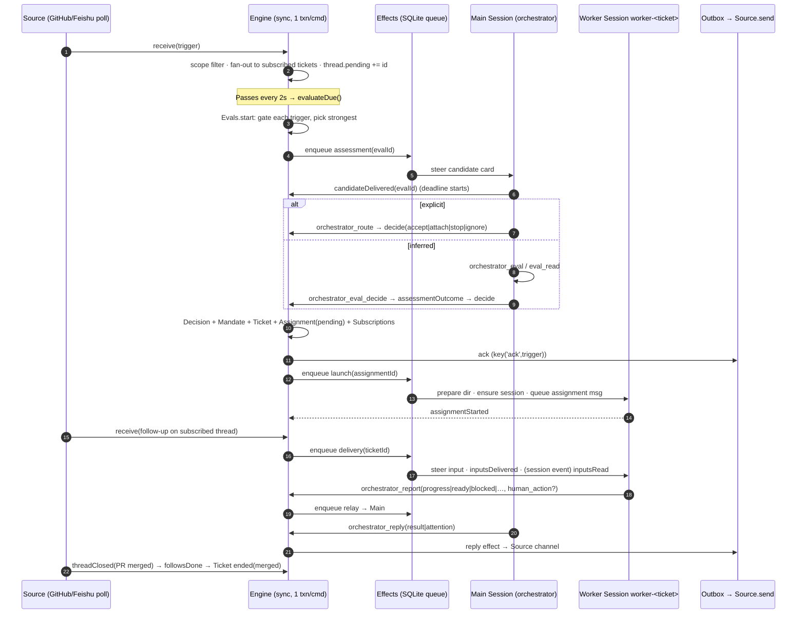

# 01 · dsh-superagent 核心引擎研究

> 范围：`dsh-superagent-prototype/` 的 docs 000/001/002/003/007、`src/core/*`、`src/executor/*`、`src/{admission,policy,limits,kv}.ts`、`prompts/{admission,dispatch,orchestrator,worker,work,handoff*}.md`。
> 为说明持久化/移植，另外查看了少量 `src/app/{store,effects,passes,sessions,assessment,runtime}.ts`。
> 下文路径省略前缀 `dsh-superagent-prototype/`。只读研究，未改动任何代码。

## 0. 一句话总结

一个**单进程、单写者、同步事务**的领域引擎（`src/core`，纯 TS，不做 I/O），外面包一层 **DeepSeek Harness (DSH)** 适配：
1 个长期存在的 *main Session*（orchestrator，负责路由/评估），加上**每个 Ticket 一个** *Executor Session*（worker，`worker-<ticketId>`），
外加一个 SQLite 持久化的 *Effects* 队列，把所有副作用改成“先落库、再执行”。核心本身与基础设施无关；
真正难移植的是 DSH 的会话语义（steer/queue/inject、inbox、取消、后台 job/subagent、idle 事件）。

---

## 1. 领域模型

定义在 `src/core/model.ts`；概念说明见 `docs/001-domain.md:58-71`。

### 1.1 实体与字段

| 概念 | 关键字段 | 位置 | 备注 |
|---|---|---|---|
| `ActorRef` / `ThreadRef` / `ChannelRef` | `{source,id}`；Channel 多一个 `address` | model.ts:5-9 | `threadKey = source:id` (model.ts:12) |
| **Trigger** | `id, source, threads[] (threads[0] 是主线程), actor, human, addressed?('mention'\|'direct'), at, text, channel?, url?, meta` | model.ts:23-39 | 不可变；`text/meta` 视为不可信数据 |
| **TriggerDisposition** | `filtered?, evalId?, decisionId?, fanout[], context?[], requeued?, handbacks?[], acked?[]` | model.ts:42-61 | Trigger 的去向；决定 follow-up 归谁处理 |
| **Thread**（聚合根） | `subscriptions[], context?[], correlated[], pending[]`（防抖缓冲）, `evaluating?`, `expired?`, `meta` | model.ts:157-182 | 一个 Thread 同一时刻**最多一个 Eval** |
| **Evaluation**（Eval） | `id, triggerIds, primary?, strength, actor, basis, policyVersion, startedAt, delivered?, deadline, pausedAt?` | model.ts:136-154 | 嵌在 Thread 内，不单独建表 |
| **Decision** | `kind: ignore\|accept\|reopen\|stop\|unavailable`, `reason[]`, `strength`, `ticketId?`, `mandate?`, `audit?`, `dismissed?` | model.ts:190-209 | 按 Thread 记录 |
| **Mandate** | `strength('explicit'\|'inferred'), policyVersion, basis(MandateBasis), actor, scope` | model.ts:126-133 | 不可变；只有 accept 创建、人工 stop 撤回、重新校验失败时吊销 |
| **MandateBasis** | `via: addressed\|followup\|admission\|listed\|bot` + `source/scope/row/sender/rules/observation` | model.ts:116-123 | 供 `revalidate` 复核 |
| **Ticket**（聚合根） | `id,title,decisionId,mandate,channels[],ended?{at,by,outcome,reason},attention?,assignments[],inputs[],undelivered[],follows?[],answers?,origin{triggerId,triggerIds},execution?{name,directory,assignment},delivery?` | model.ts:277-308 | 自己定义状态，不跟随 DSH Session 的状态 |
| **Assignment** | `id, state(pending\|running\|ended), report?{state,summary,at}, deliveredAt?, idleAt?, endedReason?` | model.ts:211-233 | Ticket 与一个 Executor 实例的绑定 |
| **TicketInput** | `trigger`（含 `human/context/readAt/deliveredTo`）\| `policy-changed` \| `reopen`(遗留) \| `resumed` \| `text` \| `note` | model.ts:235-257 | 投递给 worker 的上下文 |
| `Follow` | `{thread, own, closed?{at,outcome}}` | model.ts:314 | 例如 Ticket 自己开的 PR |
| `Attention` | `{id, question, triggerId?}` | model.ts:275 | 等人回答的结构化问题 |

关于名称的说明：所谓 **Part** 是 `EnginePart`（src/core/part.ts:24），是 Intake/Evals/Tickets/Assignments/Replies 共用的基类，**不是**领域实体。**Memory** 是 `MemoryRepositories`（src/core/memory.ts），即测试用的内存版 `Repositories`，用快照实现回滚（memory.ts:16-24）；它**不是**智能体记忆。“person（人）”被刻意排除在领域概念之外（docs/001-domain.md:72, 82）。

### 1.2 状态机

**Ticket**（docs/003-execution.md:5-21；`ticketStage` 在 src/core/stage.ts:9-21）

Ticket 处于 open 时还有派生出的 *stage*，按顺序取第一个匹配项：`person/delivery`（投递失败）→ `person/answer`（有 attention）→ `person/review`（ready）→ `person/blocked|failed`（`waitsForPerson`）→ `working/queued`（没有 Assignment 或 Assignment 为 pending）→ `idle`（waiting，或 Assignment 已结束）→ `working`。
结束时的 outcome 取值：`completed|merged|closed|dropped|stopped`（model.ts:273）。

**Assignment**：`pending → running → ended`（tickets.ts:381 新建；assignments.ts:34 `started`；tickets.ts:387 / tickets.ts:358 结束）。retry、restart、resume 都会**新建** Assignment，不复用旧的。

**Report**：`progress | waiting | ready | blocked | failed | dropped`（model.ts:216）。其中 `waiting` 由 Executor 在 turn 空闲后自动上报（dsh.ts:665），`failed` 由启动或运行错误自动上报（dsh.ts:417）。

**Thread/Eval**：`pending[]` 有 Trigger → `evaluateDue` 启动一个 Eval（evals.ts:71）→ `delivered`（候选卡片送达 main Session 后才开始计时，evals.ts:48）→ 有三种结局：Decision；超时 requeue（最多 `REQUEUES=2` 次，evals.ts:19, 60-69，第 3 次记为 `unavailable`）；Policy 变化后 reassess（evals.ts:218, 223）。

---

## 2. 端到端流程

### 2.1 两条路径（docs/002-authorization.md:152-189）

1. **Eval 路径**：决定是否开启新工作。
2. **Subscription 扇出**：已订阅的 Thread 上，新 Trigger 直接作为 Input 投给 Ticket，不经过 gate，也不授予新权限。如果是人发的消息，对应 Ticket 的 worker 就“拥有”这条 follow-up（`followupOwners`，model.ts:75-88），此时 main Session 只能对它执行 stop（part.ts:32 `leftToWorkers`）。

### 2.2 Intake（src/core/intake.ts:19-62）

去重（:23）→ `SourceScope.scope` 过滤（:25-29，不通过则记 `filtered`）→ 更新各 Thread 的 `lastAt` 和 `correlated`（:34-48）→ 对已订阅 Ticket 扇出 `addInput`（:49-52，Input id 由内容推导，天然幂等）→ 如果没有 Ticket 拥有这条消息，就进入主线程的 `pending`（:58）→ 对已结束的 Ticket 执行 `wake`（:59）。

### 2.3 Eval：gate + assessment

- `Engine.evaluateDue()`（engine.ts:75）每 2 秒由 Passes 调用一次（src/app/passes.ts:28）。每个 Eval、每个 Ticket 各自用一个事务。
- `Evals.start`（evals.ts:71-119）：取出 `pending` 整批，逐条调用 `policy.gate`，取**最强**（explicit 优先于 inferred，同等强度取较晚的）作为 `primary`/actor/basis；没有可准入的就全部 ignore。`evalId = key('eval', thread, policyVersion, at, ...pending)`（:107），然后调用 `assessor.request(candidate)`。
- **Gate**（src/policy.ts:191-211）是确定性的：已列名的人 @ 了 agent → explicit；准入表 explicit 单元格 → explicit；有 Ticket 的 Thread 上的 follow-up → 已列名为 explicit、未列名为 inferred；准入表 inferred 单元格（需要 mode≠off）→ inferred；bot 只能走 `machineGate`（:171-188），而且只有列入 bot list 的才能成为 inferred。准入表默认值见 src/admission.ts:13。
- **Assessment**（模型判断）：`MasterAssessor.request` 入队 `assessment` effect（src/app/assessment.ts:104），handler 把候选卡片 steer 进 main Session 的当前 turn（assessment.ts:96）。main Session 用 `orchestrator_eval / _eval_read / _eval_decide` 做判断（prompts/admission.md）。`assessmentOutcome`（policy.ts:40-61）要求每条启用的规则都有且只有一次判断、`direction` 已确定、至少命中一条规则、并给出 `intent_evidence`。在 `observe` 模式下，inferred 的 accept 会被改写为带 `would_accept` 的 ignore（:55-58）。
- 如果是 explicit 请求，main Session 直接用 `orchestrator_route` 做 accept/attach/stop/ignore（prompts/dispatch.md:6）。此时走 `Evals.decide` 中的 `directEval` 分支（evals.ts:131-156, 271-280）。

### 2.4 Decision → Ticket

`decideEval`（evals.ts:282-304）：如果 Policy 版本已变 → `unavailable` 并 requeue；如果是 stop → 只有 explicit 才生效，生效后调用 `Tickets.end(human,'stopped')`；如果是 accept → 生成 `Mandate`，`ticketId = key('ticket', evalId)`（evals.ts:306-316），再调用 `Tickets.create`（tickets.ts:37-56）：
记下 channels → `prepareTicket` 钩子（DshExecutor.prepare，dsh.ts:238，生成 worktree 名、目录、assignment 文本）→ 第一个 Assignment(pending) → 订阅批次里所有 Trigger 的所有 Thread → 回执（outbox id 为 `key('ack', triggerId)`）→ `executor.start`。

### 2.5 执行与回报

`executor.start` 入队 `launch` effect → `launchQueued`（dsh.ts:270）先占 worker slot → `launch`（dsh.ts:424-470）：首次运行 prepare 命令（10 分钟超时，dsh.ts:28, 247）→ `sessions.ensure('worker-<id>')` → 清掉 inbox 里的旧副本（dsh.ts:448）→ 以 `queue` 模式投递 assignment 消息 → `engine.assignmentStarted`。
之后的 Input 走 `delivery` effect → `deliverQueued`（dsh.ts:290-328）**逐条** steer 进 worker session，每条之后调用 `inputsDelivered`。worker 通过工具回调 Engine：`orchestrator_report / _ack / _trigger_handback / _thread_unrelated / _thread_follow`（docs/007:519-528）。DSH 事件对应如下：`session/event user/message` → `inputsRead`（dsh.ts:495）；`agent/status idle` → `workerIdle`（dsh.ts:601），它负责 `turnEnded` 并在需要时上报 `waiting`；`agent/error` → 可重试错误就 retry，否则上报 `failed`（dsh.ts:505）。

### 2.6 回复与交接

worker 的报告经 `relay` effect（ordered，并发 1）steer 进 main Session（sessions.ts:104）。main Session 用 `orchestrator_reply purpose=answer|result|attention` 回复（`Replies`，replies.ts:36-95），每种 purpose 都有规则校验和确定性 id。消息先进 Outbox，再由 `reply` effect 通过 Source 发出。“交接”的契约见 prompts/handoff*.md：worker 用 `human_action` 提出一个结构化问题，main Session 立即用 `purpose=attention` 转发出去。

---

## 3. Orchestrator 与 Worker

| | Main Session（orchestrator） | Executor Session（worker） |
|---|---|---|
| 数量 | **全局 1 个**，id 为 `orchestrator-<key(stateDir)>`，存在 KV `master-id` 中（runtime.ts:104-105） | **每个 Ticket 1 个**：`worker-<ticketId>`（dsh.ts:24），跨 Assignment、retry、resume 复用，目录也保持不变 |
| Preset | `dsh-superagent-router`，shell/job 等待最多 5 秒，`noWait` 守卫禁止 sleep 和长时间等待（docs/007:509-515） | `dsh-superagent-worker`，前台 shell 超过 5 秒自动转后台（docs/003:327-329）；`WORK_TOOLS` 是一份白名单（sessions.ts:61） |
| 权限 | `danger-full-access`（sessions.ts:~151，两种角色都是） | 同左，以运维者的 OS 用户身份执行；命令黑名单**不是安全边界**（docs/003:380） |
| 看到什么 | 候选卡片、follow_up 通知、worker_report/attention 的 relay、注入的 notice；14 个工具（docs/007:492-507）；`orchestrator_read` 能读全部资源 | 首条消息包含 title、≤1500 字的 assignment、源 Trigger 卡片和批次（dsh.ts:451-468）；之后的 Input ≤600 字/条；只能读自己 Ticket 相关的资源（docs/007:573）；6 个工具 |
| 职责（prompt） | 只做路由，不写实现计划，不读代码（dispatch.md:14, 38-41；orchestrator.md） | 负责全部技术工作：调研、实现、PR、CI、回应 review（worker.md、work.md） |
| 模型 | `settings.eval.model` | `settings.executor.model`，只在创建 Session 时生效（docs/003:443） |

**创建方式**：`Sessions.ensure`（sessions.ts:138-155）依次调用 `sessionController.resolveAgent`，不存在时 `workspaceRegistry.create(cwd)` 加 `sessionController.create({agentPreset})`，然后 `initializeRoleModel` → `decorate`（注册 prompts/skills/tools）→ 设置权限 → rename。消息投递用 `Sessions.prompt(sessionId, requestId, text, mode)`，`mode` 取 `'queue'`（下一 turn）、`'steer'`（插入当前 turn）或 `{inject}`（不唤醒）。按 `requestId` 去重由 `AgentDelivery` 负责（sessions.ts:162-166）。

**并发与限额**
- `WorkerSlots`（dsh.ts:171-199）：默认 `maxWorkers=3`（policy.ts:93，范围 1-16，见 limits.ts）。人发来的消息可以额外多用 1 个 slot（:194），而且唤醒优先于新 launch（:182-185）。slot 一直占用到 turn 结束，**以及**后台 job/subagent 跑完为止。
- Effects 各类的并发上限：assessment 4、launch 等于空闲 slot 数、delivery 4、relay/notice/reply 各 1，且有序（docs/007:172-179）。暂停时全部置 0。
- 后台工作：turn 结束后最多再等 30 分钟（dsh.ts:32, 629-656），超时就杀 job、上报 waiting。交接给人（ready/attention/blocked）时立即释放 slot，job 留给人使用，subagent 停止（dsh.ts:588-600）。

**重试与故障**
- 暂时性错误（408/429/5xx/ECONNRESET 等，dsh.ts:44-55）：launch 最多 3 次，退避 5 秒起、翻倍、上限 300 秒（dsh.ts:232-233）；turn 失败最多 3 次，间隔 15/30/60 秒，每次发一条“继续”消息（dsh.ts:555-576）。
- prepare 失败**不重试**，直接把 Ticket 标为 failed（dsh.ts:43, 281-283）。
- `blocked/failed` 之后（`waitsForPerson`）自动 Input 会被挂起（tickets.ts:238；assignments.ts:126），直到人发消息、执行 retry、或之后的 report 不再是 blocked/failed。
- 重启时，`DshExecutor.resume`（dsh.ts:524-537）对 running 状态的 Assignment 调用 `assignmentInterrupted`，结果是带恢复说明的新 Assignment（assignments.ts:21, 83-92），或保持原样。已投递但未读的 Input 会重新排队（`requeueUntaken`，tickets.ts:333）。
- Eval 超时 2 次 requeue，第 3 次记为 `unavailable`（evals.ts:60-69）。

---

## 4. Ports（`src/core/ports.ts`）与 DSH 绑定程度

`src/core` 除了 `node:crypto` 之外**不 import 任何外部模块**，也不做 I/O（docs/007:258）。所有端口都不依赖具体基础设施，但有几条隐含的语义假设（右列）。

| 端口 | 签名要点 | 位置 | 移植时要注意的隐含假设 |
|---|---|---|---|
| `Repositories` | `atomic(work)` + triggers/threads/tickets/decisions 的 `get/save/list/active/open/byThread` | ports.ts:105-133 | **全部同步**；`atomic` 能嵌套回滚；读取时看到同一事务里刚写入的数据。`tickets.list()` 被当作全表扫描使用（replies.ts:68） |
| `Policy` | `version, paused, gate(), revalidate(), admitsInferred(), evalTimeoutMs` | ports.ts:16-26 | 纯函数，每次都从 Settings 现算（policy.ts:167） |
| `SourceScope` | `scope({source,meta}) → listened/observed/row` | ports.ts:11-13 | 同步 |
| `Assessor` | `request(candidate)`、`release?(evalId)` | ports.ts:48-52 | 只负责入队，结果异步经 `Engine.decide` 回来 |
| `Executor` | `start / deliver / stop(ticket, assignment)` | ports.ts:58-68 | 只负责入队；**结果回调**包括 `assignmentStarted / inputsDelivered / inputsRead / turnEnded / deliveryFailed / report / assignmentInterrupted`（engine.ts:269） |
| `Outbox` | `send(idempotent) / status / withdraw` | ports.ts:71-82 | 同步查状态 |
| `DomainEvents` | 13 种事件 | ports.ts:85-101 | `emit` 可选；只有 Runtime 用到（docs/007:105-109） |

Engine 按调用方角色暴露不同的 `Pick` 视图：`EngineForSources / MainSession / People / Settings / Executor`（engine.ts:261-270）。

**与 DSH 强绑定的部分**（依赖 `@deepseek-ai/*`：cordis 16 处、dsh-agent 10 处、dsh-session 7 处……）：
- `src/executor/dsh.ts`：`Context`、`Agent`、`agent.inbox.remove`、`agent.cancel({keepInbox})`、`agent.status/whenIdle`、`session.snapshotEvents()`、`ctx.on('agent/status'|'agent/inbox/claimed'|'session/event'|'agent/error')`、`ctx.subprocess`。
- `src/executor/background.ts`：`ctx.get('jobs')`、`ctx.get('subagents')`（:10-21, 29-30），即 DSH 的 job 注册表和 subagent 服务。
- `src/app/sessions.ts`、`delivery.ts`：`sessionController`、`workspaceRegistry`、`permissionPresets`；steer/queue/inject 三种投递语义。
- `src/app/assessment.ts`：把评估做成**在 main Session 内部**完成的工具调用，并非单独的模型调用。
- `src/app/tools/*`、`prompts.ts`、`http.ts`、`client/*`：工具注册、system prompt 组装、Web 面板、Plugin Manager。
- `cordis.patch.yml`：bundle、两个 preset、插件装配。

**与基础设施绑定、但与 DSH 无关的部分**：Store（`node:sqlite`）、Effects（SQLite 表）、`proper-lockfile`、Passes（`setInterval`）、Sources（`gh` / `lark-cli` CLI）、`runAsWorker`/环境 shim（src/infra）。

---

## 5. 持久化、一致性与幂等

### 5.1 存放位置（docs/007:450-486）

整个状态是一个 SQLite 文件 `<stateDir>/orchestrator.sqlite`（WAL 模式，`synchronous=FULL`，store.ts:2, 60-64）：

| 表 | 内容 | 写入方 |
|---|---|---|
| `trigger`, `trigger_thread`, `disposition` | Trigger、Trigger 与 Thread 的索引、Trigger 的去向 | Engine |
| `thread` | 订阅、pending、进行中的 Eval（JSON），生成列 `active`/`subscribed` | Engine；`meta` 由 Source 写 |
| `ticket` | 整个聚合（Mandate/Assignments/Inputs/Channels/Follows 都放在 JSON 里），生成列 `open`/`active` | Engine |
| `decision` | Decision，按 Thread 记录 | Engine |
| `effect` | 以 (kind,key) 为唯一键的副作用队列：payload、order、attempts、due | Effects |
| `outbox` | 每条外发消息的回执 `pending/sent/dropped` | Outbox |
| `kv` | Settings/Prompts 的版本快照、`master-id`、每个 Session 的 prompt 版本、Source 游标（`KV`，src/kv.ts:45-82） | 各自的 owner |

另外：DSH 自己持久化 Session 的对话记录，以及 `<stateDir>/work/<name>` 下的工作目录（git worktree）。内存缓存（`TextCache`）和 `WorkerSlots`/`settling`/`transient` 在重启后丢失，这是设计时有意接受的。**目前没有任何清理逻辑**，数据会无限增长（docs/007:484）。

### 5.2 一致性与锁

- **单进程单写者**：`lockSync(stateDir, {stale: 30_000, onCompromised})`（runtime.ts:93）。锁失效就中止运行时。整个设计假设只有一个 Engine 实例。
- **每个命令一个事务**：`Store.atomic` 用 SAVEPOINT 实现，可以嵌套（store.ts:140-144）。`evaluateDue` 按 Eval/Ticket 拆成多个小事务（engine.ts:75-87）。
- **副作用分两档**：持久的走 `Effects.enqueue`，在事务内写入，提交后才执行（docs/007:166）；只在内存里的（例如取消 turn）走 `afterCommit`，回滚则不执行（store.ts:159；dsh.ts:363）。
- **乐观重读**：异步 handler 在每次 `await` 之后都重新读 Ticket，检查它仍为 live、且 Assignment 没被替换（dsh.ts:271-273, 299-302, 331-336, 425-430）。这起到了类似“版本校验”的作用。
- Thread 级串行：同一 Thread 同时只跑一个 Eval，期间到达的 Trigger 合并进下一批。

### 5.3 幂等

- 所有 id 都由内容推导：`key(...)` = sha256(JSON) 取前 32 位 hex（ids.ts:3）。
  例如：`decision = key('decision', evalId)`、`ticket = key('ticket', evalId)`、`assignment = key('assignment', ticketId, n)`、`input = key('input', ticketId, 'trigger', triggerId)`、`ack = key('ack', triggerId)`、`attention-reply = key('attention-reply', attentionId)`。
- Trigger 重复到达直接返回 `duplicate`（intake.ts:23）；一个 Trigger 已经创建过 Ticket 时，再次 accept 会返回原来的 Decision（evals.ts:137-146）。
- `addInput` 按 id 去重（tickets.ts:235）；Effects 的 (kind,key) 唯一，重复入队只替换 payload；`AgentDelivery` 保证每个 requestId 只投递一次；Outbox 的 id 一旦写入就不会再次入队。
- 结论：**整体能承受至少一次（at-least-once）投递**，这对迁到 SQS/EventBridge 是有利条件。

---

## 6. 移植到 AWS 的笔记

### 6.1 能比较自然地映射的部分

| 原组件 | AWS 候选 | 说明 |
|---|---|---|
| `src/core`（Engine + ports） | 原样复用（TS，可跑在 Lambda/ECS） | 不依赖 DSH；领域规则和测试（`tests/core-engine.spec.ts`）可以直接带过去 |
| 内容推导 id + 幂等 | SQS / EventBridge 的至少一次投递 | 现成兼容 |
| Trigger/Thread/Ticket/Decision 表 | DynamoDB（PK=聚合 id，聚合整体存 JSON，与现状一致） | 生成列 `active/open/subscribed` 对应 GSI 稀疏索引 |
| `effect` 队列 | 方案一：DynamoDB effect 表 + Streams；方案二：每个 kind 一条 SQS 队列（relay/notice/reply 用 FIFO，MessageGroupId 取 ticketId+conversation） | 退避用 SQS visibility timeout 或 EventBridge Scheduler |
| Outbox 回执 | DynamoDB 条件写（`attribute_not_exists`） | |
| Passes 每 2 秒的 `evaluateDue` | 方案一：ECS 常驻 ticker；方案二：EventBridge Scheduler 为每个 Eval 设一个 deadline 定时，再加上 Trigger 到达即触发 | Lambda 的最小定时粒度是 1 分钟，所以要改成事件驱动 |
| worker = 每 Ticket 一个 Session、一个目录 | **AgentCore Runtime session**（`runtimeSessionId = worker-<ticketId>`），目录放在 **S3 Files 挂载**上 | microVM 隔离比现在的“同一 OS 用户 + 命令黑名单”强得多 |
| Settings/Prompts 版本 | DynamoDB 或 S3 加版本号 | `policyVersion` 是哈希，与存储无关 |
| Sources（轮询 gh/lark） | Lambda + EventBridge Scheduler，或者改用 webhook 接入（API GW → SQS） | 读游标存在 DynamoDB |

### 6.2 难点 / 需要重新设计的部分

1. **`Repositories` 是同步接口加 `atomic`**：DynamoDB 是异步的，而且事务不支持“读到自己刚写的数据”。可选方案：(a) 改为工作单元模式：命令执行前异步加载涉及的聚合，在内存里同步运行 Engine（用 `MemoryRepositories` 的思路），最后用 `TransactWriteItems` 带版本条件一次提交（上限 100 项），冲突就重试。但命令里有**集合查询**（`threads.active()`、`tickets.open()`、`tickets.list()`、`decisions.byThread`），需要预取或改成 GSI 查询。(b) 把整个 core 改成 async，改动大、风险高。推荐 (a)，再配合按 threadKey/ticketId 串行化（SQS FIFO 的 MessageGroupId）来降低冲突。
2. **单写者假设**：现在用 `proper-lockfile` 加单进程。在 AWS 上要么只跑一个 Engine 实例（ECS desired=1，再加 DynamoDB 租约锁），要么彻底改造成按聚合串行加条件写。`WorkerSlots` 是内存计数，要改成 DynamoDB 原子计数器或信号量。
3. **DSH 会话语义没有直接对应物**：AgentCore Runtime 是“invoke 时请求/响应流式返回”的模型（session 最长 8 小时，空闲 15 分钟后回收，以官方文档为准）。下面这些能力都要在 worker 容器里自己实现：
   - `steer`（向正在运行的 turn 插入消息）和 `queue/inject`。需要在 agent 循环的每一步之间读取一个 inbox（DynamoDB/SQS），并在“读入 history”时回调 `inputsRead`。
   - `agent/status idle` → `turnEnded/waiting`，`agent/error` → 可重试错误的续跑。
   - `cancel({keepInbox})`、后台 shell job / subagent 的生命周期（30 分钟上限、交接后 job 继续运行但不占 slot、唤醒）。这块在 background.ts 和 dsh.ts:588-672 里大约 300 行，是最难的。
   - Session 被回收以后，对话记录要能恢复（AgentCore Memory 或自建 transcript 存储），并且要支持 `sessions.holds(requestId)` 这类“消息是否已投递”的查询。
4. **main Session 是一个长期存在、串行的 LLM 会话**，所有候选、relay、notice 都 steer 进同一个上下文（还依赖 compaction，见 dispatch.md:44）。迁移时可以改成每个候选或每批做一次无状态调用（上下文由卡片加 `orchestrator_read` 提供），但这会改变现有 prompt 的假设（“follow_up 通知”“不要重复里程碑”等都依赖会话记忆）。
5. **工具回调方向**：worker 的 6 个工具和 main Session 的 14 个工具会同步调用 Engine 并返回卡片。到 AWS 上要暴露成 API（AgentCore Gateway MCP 或 API GW + Lambda），并做身份绑定：worker 只能操作自己的 ticketId（现在通过 sessionId 前缀推断，dsh.ts:26）。
6. **按用户隔离与领域模型存在冲突**：原设计**明确拒绝**引入 Principal/Membership 实体，也不做跨 Source 的身份映射（docs/001:82）。Ticket 只有 `mandate.actor`（某个 Source 下的身份），没有“用户”。按用户挂载 S3 Files，需要引入新的映射（比如 actor→用户，或者按 Ticket/租户来挂载）。这是**架构层面的决策**，要在设计阶段明确。另外，workspace 目前位于 `stateDir/work/<name>`，prepare 命令用 `git worktree`（docs/003:349-353），而 worktree 需要共享同一个主仓库。改成每个 Ticket 一个微虚机加 S3 Files 后，要换成 clone，或者共享只读的 bare repo。
7. **时间语义**：Eval 的 deadline 从“送达 main Session”开始计时、暂停时顺延（evals.ts:35-58），Effects 的 due/backoff，30 分钟后台上限，Source 的两周轮询窗口（docs/003:416）。这些都要换成 Scheduler/TTL 来实现。
8. **规模**：Replies 里有 `tickets.list()` 全表扫描（replies.ts:68），`threads.active()`/`tickets.open()` 也在每次 pass 时全量读取，在 DynamoDB 上需要改成索引查询。

### 6.3 建议的移植切分（供后续设计参考）

- **L0 原样复用**：`src/core/*`、`src/policy.ts`、`src/admission.ts`、`src/limits.ts`、prompts（去掉 DSH 特有的工具说明后）。
- **L1 重写适配器**：`Repositories`→DynamoDB 工作单元；`Effects`→SQS/DDB；`Outbox`；`Passes`→Scheduler；`SourceScope`/Sources 原样或改为 webhook。
- **L2 重新设计**：`Executor`→`AgentCoreExecutor`（launch=创建 session 并首次 invoke；deliver=写 inbox 并在需要时唤醒 invoke；stop=StopRuntimeSession 或取消）；在 worker 容器里实现 inbox/steer、idle/error 事件回调、后台 job 管理；main Session 改成无状态或单会话；工具改走 Gateway；按用户映射 S3 Files。
